

nutriFlow: mercado de barrio a domicilio en cinco países

Nilson Aldair Molina Rengifo Juan Fernando Cruz Cárdenas Julián David Romero Baquero

Facultad de Ingeniería y Ciencias Básicas, Universidad Central Ingeniería de Sistemas y Computación

Sistemas Distribuidos: Proyecto de asignatura, diseño de un sistema distribuido

Noviembre de 2026

## 1. La oportunidad de negocio

**Problema.** En las ciudades grandes la gente no tiene tiempo de ir a la plaza o a la tienda del barrio, mientras esas tiendas pasan buena parte del día sin clientes y hay repartidores esperando pedidos. Las plataformas grandes atienden sobre todo restaurantes y cadenas, y la tienda pequeña queda por fuera porque no tiene catálogo digital ni puede pagar comisiones altas. El canal es grande: en Colombia hay cerca de 500.000 tiendas de barrio (Fenalco) y concentran el 37 % de las ventas de consumo masivo (NielsenIQ, 2026).

**Caso diseñado: mercado de barrio y almuerzo del día en 30 minutos.** El cliente arma su lista y la app consulta en paralelo las tiendas cercanas para decirle cuál le sale más barata con todo en stock. En la misma compra puede pedir el almuerzo de una cocina del barrio. Las ciudades piloto son Bogotá, São Paulo, Nueva York, París y Tokio. Escogimos Japón como quinto país porque es el que describen las tablas 3.1 a 3.3 del enunciado, que el propio enunciado llama "el contrato de configuración". Además es el caso más exigente: escritura japonesa, apellido primero, moneda sin decimales y sin propina. Alemania se agregaría solo con datos (sección 4).

**Comparación de Rappi e iFood**

| | Rappi (Latinoamérica) | iFood (Brasil) |
|---|---|---|
| Clave de negocio | Comisión al comercio por pedido, más domicilio, suscripción Prime y publicidad | Comisión por pedido (menor si el restaurante pone el repartidor), más publicidad y servicios financieros |
| Subsistemas | Catálogo, pedidos, pagos, asignación de repartidores, seguimiento, notificaciones | Los mismos, más gestión del restaurante |

**Nuestra diferencia.** Trabajamos con tiendas de barrio y no con cadenas, cotizamos la lista completa en todas las tiendas cercanas a la vez y usamos un mismo sistema para los cinco países.

**Por qué es un sistema distribuido.** Tiene los cinco síntomas vistos en clase. Hay geografía, con usuarios, tiendas y regiones en cinco países, y multiproceso, porque atiende muchos pedidos, tiendas y repartidores al mismo tiempo. Las apps, las regiones, el intermediario de mensajes, las pasarelas y los mapas están interconectados, y el catálogo, la flota y el estado del pedido son compartidos. Por último, debe tolerar fallas: si cae un nodo, el pedido no se pierde (sección 8).

## 2. Propuesta de solución

nutriFlow conecta al cliente, la tienda, el repartidor y el administrador de cada país. El sistema ubica al cliente, cotiza su lista en las tiendas cercanas, cobra en la moneda local con el impuesto y la propina del país, asigna el repartidor más cercano con menos carga, muestra el recorrido en vivo y emite el comprobante de cada país.

**Modelo de ingresos.** La plataforma cobra a la tienda una comisión sobre el subtotal, que es su ingreso principal, y al cliente una tarifa de domicilio, con la que le paga al repartidor. La publicidad (tienda destacada en el mapa) está prevista en el diseño, pero el prototipo no la implementa. La propina va completa al repartidor. Todos estos valores son datos del perfil de cada país.

**Comisión, domicilio e ingreso por país**

| País | Comisión | Domicilio (gratis desde) | Ingreso bruto del pedido de la sección 9 | Comisión neta |
|---|---|---|---|---|
| Colombia | 15 % | $ 5.900 ($ 90.000) | $ 11.570 (2,97 USD) | $ 5.670 |
| Brasil | 15 % | R$ 7,99 (R$ 120,00) | R$ 17,86 (3,31 USD) | R$ 9,87 |
| Estados Unidos | 18 % (15 % por entrega y 3 % por transacción) | $3.99 ($35.00) | $9.39 (9,39 USD) | $5.40 |
| Francia | 17 % | 2,99 € (30,00 €) | 7,38 € (8,02 USD) | 4,39 € |
| Japón | 14 % | ￥330 (￥3,500) | ￥604 (3,97 USD) | ￥274 |

El ingreso bruto suma comisión y domicilio; como el domicilio se le paga al repartidor, lo que le queda a la plataforma es la comisión. En Estados Unidos la comisión respeta el tope de Nueva York, que permite cobrar al restaurante hasta 15 % por la entrega y 3 % por procesar el pago (NYC Admin. Code § 20-563.3). Los valores no son iguales en dólares porque cobramos lo que cuesta un mandado en cada ciudad (Anexo A.4).

**Alcance.** Cinco países y una ciudad por país. Los pagos, la mensajería y el envío a la autoridad fiscal son simulados, y los productos y precios también, aunque las tiendas son reales (OpenStreetMap).

**Supuestos.** Las tiendas tienen un teléfono inteligente con datos, los repartidores son independientes y usan su propio teléfono, la pasarela de pago de cada país tokeniza la tarjeta y el domicilio se trata como no gravado (Anexo A.2).

**Restricciones.** Ninguna regla por país en el código, dinero sin decimales flotantes, tiempo en UTC, datos personales dentro de su país y datos de prueba ficticios.

## 3. Diseño funcional

### 3.1 El sistema y sus subsistemas

**Diagrama de contexto**

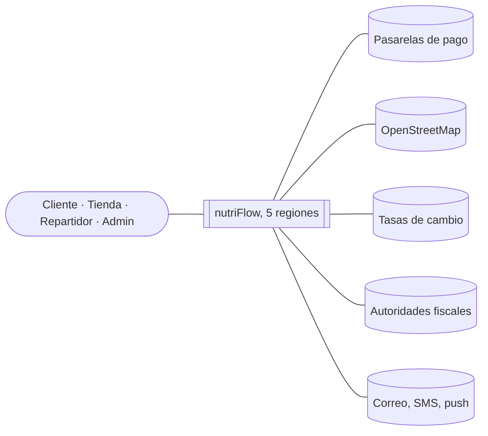

Siguiendo a Bertalanffy, nutriFlow es un sistema abierto: recibe pedidos, dinero y posiciones del entorno y devuelve entregas, comprobantes y avisos. Lo dividimos en diez subsistemas; en el grafo, el recuadro "Región del país" es Pedidos con sus módulos. Cuatro corren como procesos separados que solo se comunican por mensajes: Pedidos (una región por país), Pagos, Logística y Notificaciones, unidos por el intermediario de mensajes. Identidad, Catálogo, Localización y Facturación son módulos que corren dentro de cada región; en el diseño objetivo se separan como servicios. Monitoreo es la consola del administrador, que escucha la salud que publica cada proceso.

**Grafo de subsistemas**

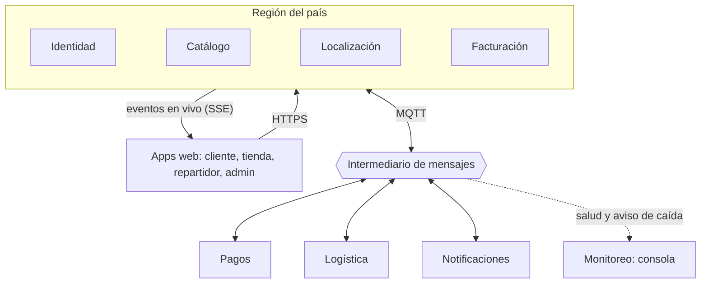

**Subsistemas y funciones**

| Subsistema | Funciones | En el prototipo |
|---|---|---|
| Pedidos | Crear, aceptar, rechazar, cancelar y calificar; es el dueño del estado del pedido | Proceso por país |
| Pagos | Cobro y reembolso con los medios del país, sin cobrar dos veces | Proceso |
| Logística y asignación | Flota, asignación por cercanía, disponibilidad y carga; posiciones en vivo | Proceso |
| Notificaciones | Un aviso por actor y paso; cada app lo muestra en su idioma y su hora | Proceso |
| Intermediario de mensajes | Publicación-suscripción, colas, último estado retenido y aviso de caída | Proceso |
| Identidad y perfiles regionales | Sesión por rol, perfil de cada país, cambios del administrador | Módulo de la región |
| Catálogo | Productos, precios por país y por tienda, búsqueda por cercanía | Módulo de la región |
| Localización | Textos por idioma con respaldo; formato de números, monedas, fechas y direcciones | Módulo de la región y de la app |
| Facturación e impuestos | Impuesto del país, propina y comprobante con su formato | Módulo de la región |
| Monitoreo | Salud de cada proceso, caídas, ventas consolidadas | Consola del administrador |

### 3.2 Transacciones atómicas

Dentro de cada nodo, cada cambio del pedido es una transacción ACID que se confirma o se revierte completa. Entre subsistemas usamos una saga (Garcia-Molina y Salem, 1987): cada paso se confirma en su nodo y, si uno posterior falla, se compensa cancelando el pedido o reembolsando. Descartamos la confirmación en dos fases (2PC) por dos razones. Si cae el coordinador, todos los participantes quedan bloqueados con sus recursos retenidos. Y aunque autorizar y capturar una tarjeta se parece a preparar y confirmar, la pasarela no participa como recurso de un protocolo XA: la retención vence sola y no vota con un coordinador. Los mensajes por MQTT llegan al menos una vez, así que los receptores son idempotentes y repetir un mensaje no cobra ni avisa dos veces. Todos los mensajes van en JSON con UTF-8.

**Transacciones entre subsistemas**

| Transacción | Mensaje | Confirmación y reversión | Si falla |
|---|---|---|---|
| T1 Crear pedido App → región, HTTPS | `{id, tienda, cliente, líneas, entrega, propina, pago}` | Se confirma cuando la región recalcula precios e impuestos y guarda. Si un dato es inválido, no se guarda nada | La app reintenta en la réplica; si el pedido ya existe, recibe el mismo |
| T2 Cobrar Región → Pagos → región, MQTT | Solicitud `{pedido, monto, moneda, medio, token}` y resultado `{pedido, aprobado, referencia}` | Se confirma con el pago capturado. Si se rechaza, el pedido se cancela (compensación) | El cobro espera en la cola hasta que Pagos vuelve; la tienda no puede aceptar un pedido sin pagar |
| T3 Cancelar App → región, HTTPS | Cancelación o rechazo del pedido | Se confirma con el pedido cancelado; si estaba cobrado, dispara T4, también si el cobro llega después | Si el pedido ya va en camino, se rechaza |
| T4 Reembolsar Región → Pagos, MQTT | `{pedido, monto, moneda}` | Pagos marca el cobro como reembolsado. Es la compensación de T2 | Se reentrega desde la cola; un duplicado no reembolsa dos veces |
| T5 Asignar repartidor Logística → región, MQTT | `{pedido, repartidor, nombre}` | Se confirma si el pedido sigue listo y sin repartidor. Si el repartidor rechaza, el pedido vuelve a estar listo | El pedido espera hasta que Logística vuelve |
| T6 Cambio de estado Apps → región, HTTPS | Aceptar, listo, recoger, entregar o calificar | Se confirma si el cambio es válido para el estado actual; si no, se rechaza con 409 sin escribir nada | La app reintenta en la réplica (Anexo A.2) |
| T7 Avisar Región → Notificaciones, MQTT | `{estado anterior, pedido}` | Se guarda un aviso por actor con identificador único | Un aviso repetido se descarta |
| T8 Cambiar perfil regional Consola → región, HTTPS y MQTT | `{impuestos, domicilio, propina, comisión}` | Las instancias de la región reciben el valor nuevo como mensaje retenido; deshacer vuelve al perfil original | Solo el administrador puede hacerlo |

**Secuencia de un pedido sin fallas**

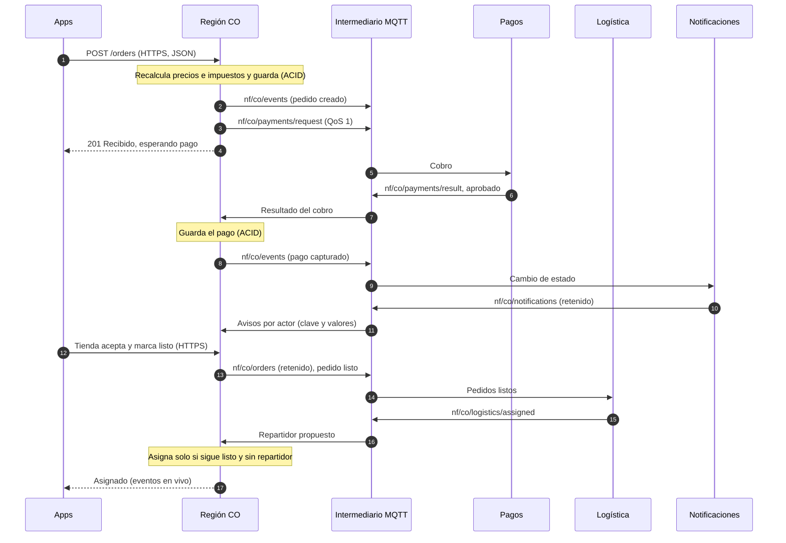

El caso más delicado de la saga se da cuando el cliente cancela mientras el cobro sigue en la cola y el cobro se aprueba después. Como un cobro capturado no se puede deshacer, la región lo compensa con un reembolso (T4). Es la prueba "Cancelar con el pago en camino" del Anexo D.1.

**Secuencia de la compensación con Pagos caído**

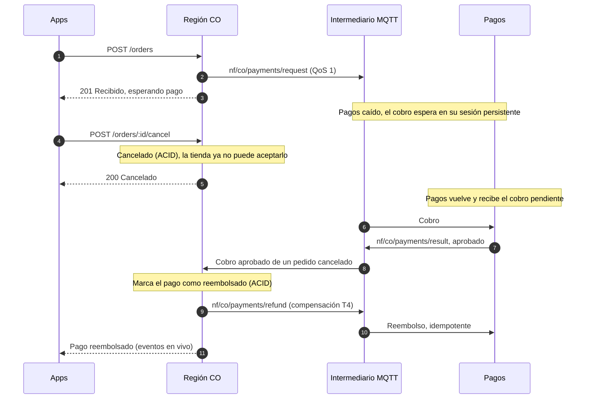

### 3.3 Comunicación y middleware

**Tecnologías de comunicación**

| Interacción | Tecnología y modelo | Protocolo | Por qué esta y no otra |
|---|---|---|---|
| App → región | Servicio web REST/JSON, petición-respuesta | HTTPS sobre TCP | El navegador lo habla sin librerías. gRPC necesitaría un proxy gRPC-Web, y el navegador no abre sockets crudos |
| Región → app, en vivo | Server-Sent Events, flujo de un solo sentido | HTTP `text/event-stream` sobre TCP | El servidor solo empuja estado y el navegador se reconecta solo; WebSocket daría un canal de vuelta que no usamos |
| Región ↔ Pagos, Logística, Notificaciones | MQTT con QoS 1 y sesión persistente, publicación-suscripción con cola | MQTT sobre TCP 1883 (8883 con TLS) | Desacopla en el tiempo: si Pagos está caído, el cobro espera en la cola. Con RPC la región tendría que esperar la respuesta |
| Posición del repartidor | MQTT QoS 0, una vez por segundo | Prototipo: TCP. Objetivo: MQTT sobre QUIC (UDP) | Cada posición reemplaza a la anterior y perder una no importa (sección 7.3) |
| Flota, perfiles y pedidos recientes | MQTT con mensaje retenido | MQTT sobre TCP | Un suscriptor nuevo recibe el último valor sin pedirlo |
| Aviso de caída | MQTT Last Will | MQTT sobre TCP | El intermediario publica `offline` en nombre del proceso que se cayó, así que nadie tiene que consultar su estado |
| Pagos → pasarela real | REST con clave de idempotencia | HTTPS sobre TCP | Es lo que exigen los proveedores de pago |

**Middleware.** Elegimos MQTT, el middleware que estudiamos en la tarea de la asignatura. Es una norma abierta (ISO/IEC 20922, OASIS) y es ligero en redes móviles. Sus colas guardan los mensajes mientras un servicio está caído, retiene el último estado de cada tema y avisa cuando un proceso se cae. Frente a las alternativas vistas en clase obtuvo 33 de 40 puntos; RabbitMQ sacó 29, Kafka 27, gRPC 23 y REST 21 (Anexo A.1). MQTT resuelve la heterogeneidad de lenguaje, sistema operativo, hardware y red, y desacopla al emisor del receptor en el tiempo y en el espacio. La heterogeneidad del formato de los datos la resolvemos con JSON en UTF-8 y el perfil regional. En el prototipo hay un solo intermediario y es un punto único de falla: si cae, las regiones no pueden confirmar comandos que publican mensajes (Anexo A.5). En el diseño objetivo hay uno por país, en clúster y con persistencia en disco, conectado a un núcleo que solo recibe salud y métricas.

### 3.4 Sincronización, datos y nombres

- **Tiempo.** Todos los instantes se guardan en UTC y los relojes se sincronizan con NTP (sección 7.2). No hay reloj global. Cada pedido tiene un solo escritor, la región de su país, que serializa sus transacciones, y un número de versión: la cantidad de pasos de su historial, que crece en uno con cada transición. Ese contador da un orden total a los eventos del pedido sin depender de la hora física. Es la idea del reloj lógico de Lamport (1978) para un escritor único; el algoritmo distribuido completo no hace falta porque nunca hay dos escritores del mismo pedido.
- **Exclusión mutua.** La región dueña del pedido es el coordinador centralizado: solo asigna repartidor si el pedido sigue listo y sin repartidor, y rechaza la segunda propuesta. Así un pedido nunca tiene dos repartidores.
- **Asignación con balanceo de carga.** Logística elige entre los repartidores disponibles, con menos de su carga máxima y que no hayan rechazado ese pedido, al de menor puntaje `distancia a la tienda × (1 + entregas en curso)`. Cada entrega que lleva cuenta como si estuviera más lejos.
- **Elección de líder.** En el diseño objetivo, Logística corre en un par activo-pasivo y la base de cada país en primario y réplica. El líder se elige con un permiso temporal (*lease*) en un almacén con consenso, como etcd con Patroni: quien tiene el permiso es el líder y, si no lo renueva, el otro lo toma. Preferimos esto al algoritmo del matón (*bully*) o al de anillo porque con dos nodos el permiso evita que ambos se crean líderes durante una partición de red. En el prototipo la app del navegador elige con un candado del navegador qué pestaña dirige el modo automático.
- **Interbloqueo.** En la región cada transacción toma un único candado, la escritura sobre la base del país, y espera como máximo 5 s; así no se da la condición de retención y espera (Coffman et al., 1971). En el navegador hay dos candados, pero siempre se piden en el mismo orden (líder y luego estado), lo que impide la espera circular.
- **Datos.** Partimos por país: una base por región. El estado del pedido y la asignación tienen consistencia fuerte, porque viven en la base del país y cambian por transacción ACID. El pago es fuerte dentro de Pagos y eventual entre Pagos y la región, porque se coordina por la saga: mientras tanto el pedido queda "esperando pago". Avisos, flota, posiciones y catálogo son eventuales. En términos del teorema CAP (Brewer, 2000; Gilbert y Lynch, 2002), pedido y pago prefieren consistencia y flota y avisos prefieren disponibilidad (Anexo B.6). Hay caché en el navegador, en la región y en el intermediario (mensajes retenidos).
- **Réplica.** En el prototipo la réplica de Colombia es una segunda instancia sobre el mismo archivo de datos: demuestra la conmutación del proceso, pero no protege contra la pérdida del disco. En el diseño objetivo cada país tiene un primario y una réplica síncrona de PostgreSQL en otra zona, sin pérdida de pedidos confirmados.
- **Nombres.** Un directorio asigna a cada país las direcciones de su región (primario y réplicas) y del intermediario; los temas de mensajes se nombran por país y recurso (`nf/<país>/<recurso>`). En el diseño objetivo el directorio es el DNS de cada país (sección 7.2).

## 4. Objetivos de un sistema distribuido

| Objetivo | Cómo lo logra el diseño |
|---|---|
| Transparencia | De acceso y posición: el usuario no sabe qué instancia lo atiende. De migración: mover una región es cambiar su dirección en el directorio o en el DNS. De concurrencia: las transacciones serializan los cambios de cada pedido. De replicación y fallas: si cae el primario de Colombia atiende la réplica sin que el cliente haga nada. De crecimiento: un sexto país entra con datos. De heterogeneidad: el mismo código atiende cinco países. En tres casos preferimos no ocultar: la moneda y el impuesto local siempre se muestran, el pedido dice "esperando pago" si Pagos no responde, y el operador ve el estado de cada nodo |
| Fiabilidad | Cada subsistema es un proceso aparte y la caída de uno no tumba a los demás, salvo el intermediario en el prototipo (Anexo A.5). Si cae un país, los otros cuatro siguen. En el diseño objetivo la réplica asume en cerca de un minuto: tres chequeos de salud fallidos cada 10 s más los 30 s de TTL del DNS. Con réplica síncrona no se pierde ningún pedido confirmado |
| Rendimiento | Caché del catálogo, cotización en paralelo a todas las tiendas, trabajo pesado en segundo plano por la cola y cada cliente atendido en su país. Meta: crear un pedido en menos de 300 ms (percentil 95), menos que si todos fueran a un centro de datos único en otro continente |
| Escalabilidad | En el diseño objetivo ningún nodo, tabla ni algoritmo guarda el estado global y no hay reloj global, así que para crecer basta con agregar copias de los servicios sin estado. El prototipo tiene tres centralizaciones conocidas: el directorio, el intermediario único y las bases de Pagos y Notificaciones (Anexo A.2) |
| Flexibilidad | Interfaces públicas y estándares abiertos: HTTP, MQTT, JSON, UTF-8, ISO 4217, zonas horarias de IANA y CLDR. Un sexto país se agrega con su perfil, su lista de precios y sus textos |
| Seguridad | En el prototipo: acceso por rol con token firmado, precios recalculados en el servidor, tarjeta tokenizada y límite de tamaño por petición. En la demostración el rol se elige sin contraseña. En el diseño objetivo: TLS en todo, proveedor de identidad, firewall de aplicación y permisos por país en el intermediario (sección 7.4, Anexo A.3) |
| Manejo de fallas | Detección por aviso de caída y chequeos de salud, enmascaramiento con la réplica, retransmisión desde las colas, tiempos de espera de 5 s en la app y transacciones ACID con compensación |

## 5. Localización en los cinco países

Cada país es un perfil regional guardado como dato, más su lista de precios. El perfil tiene 18 atributos: idioma, moneda y decimales, zona horaria, reloj, primer día de la semana, medidas, teléfono, código postal, campos de dirección, orden del nombre, impuesto, comprobante, identificación fiscal, medios de pago, propina, festivos, ley de datos y fuentes (Anexo B.1). El administrador cambia tasas, domicilio, propina y comisión desde la consola.

**Reglas de localización.** Usamos UTF-8 en toda la cadena y guardamos los textos en un catálogo por idioma, con el inglés como respaldo. Los números, monedas, fechas y distancias se formatean con la API `Intl` del navegador, que se basa en CLDR, nunca concatenando a mano. El dinero se guarda como entero en la unidad menor. ISO 4217 le asigna dos decimales al peso colombiano, pero en la práctica no se usan centavos, así que el perfil de Colombia declara cero decimales igual que el de Japón, y los impuestos incluidos se redondean a la unidad. Los instantes se guardan en UTC y se muestran en la zona del usuario. Las tasas de cambio llevan fuente y fecha y solo sirven para los reportes del administrador. La dirección, el teléfono y el nombre siguen el formato de cada país (en Japón va primero el apellido), y la interfaz usa fuentes japonesas y botones sin ancho fijo. El detalle regla por regla está en el Anexo B.3.

**Impuesto del almuerzo por país**

| País | Impuesto | Cálculo |
|---|---|---|
| Colombia | Impuesto Nacional al Consumo 8 % (restaurantes) | Incluido en el precio |
| Brasil | ICMS 4 %, régimen especial de restaurantes (Decreto SP 69.314/2025) | Incluido y "por dentro": 4 % del precio |
| Estados Unidos | Sales tax 8,875 % (Nueva York) | Se suma al precio |
| Francia | TVA 10 % (plato para consumo inmediato) | Incluida |
| Japón | 消費税 8 % (tasa reducida, para llevar) | Incluido |

Verificamos las tasas en fuentes oficiales (Anexo E.1). El Decreto 69.314/2025 subió el régimen de São Paulo de 3,2 % a 4 % desde enero de 2025; un juzgado de primera instancia suspendió su efecto retroactivo para algunas cadenas, lo que no cambia la tasa vigente en noviembre de 2026.

**Datos personales.** Decidimos que cada región guarde en su país los datos de sus clientes. Ninguna de las cinco leyes lo exige: la Ley 1581 (Colombia), la LGPD (Brasil), el RGPD (Francia) y la APPI (Japón) permiten transferir datos con garantías. Pero así cumplimos sin depender de las reglas de transferencia internacional de cada una. El registro ya pide el consentimiento citando la ley del país; el derecho de supresión es diseño objetivo (Anexo B.4).

## 6. Diseño gráfico

Hicimos una sola app web con un menú por rol, pensada primero para el teléfono (barra inferior al alcance del pulgar, controles grandes) y en varias columnas en escritorio. Los paneles son de vidrio translúcido sobre una foto de mercado. Los colores son tinta #13201A, naranja #D85A06 para la marca y verde #2E7D4F para los estados buenos. Usamos las fuentes del sistema, con familias japonesas, e íconos de línea. Las pantallas de las cuatro apps están en el Anexo B.7.

**Mapa de navegación**

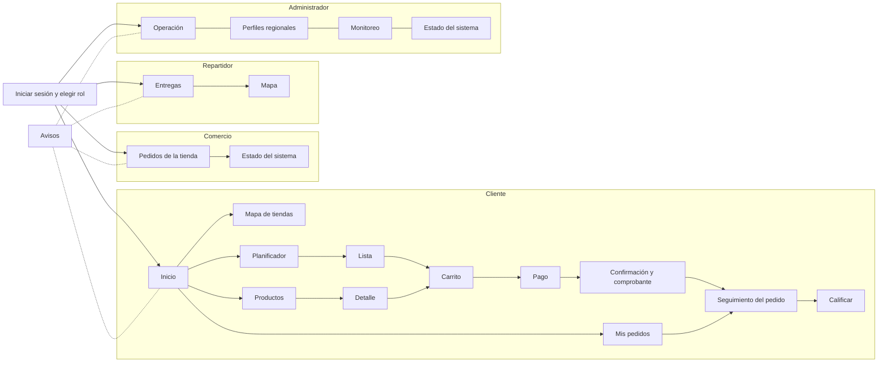

**Estados del pedido**

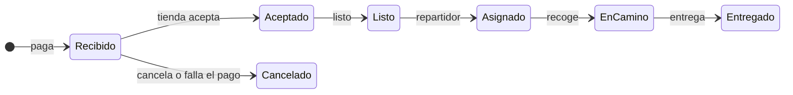

**El mismo comprobante en los cinco idiomas**

| Colombia | Brasil | Estados Unidos | Francia | Japón |
|---|---|---|---|---|
| 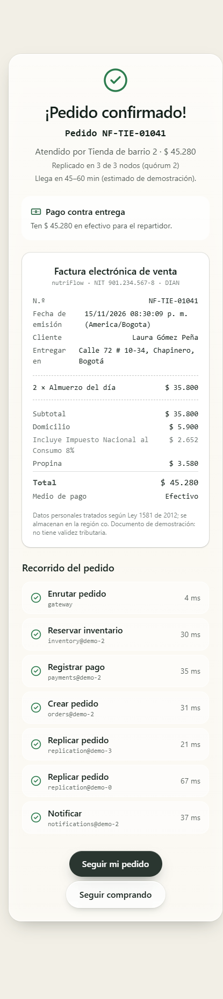 | 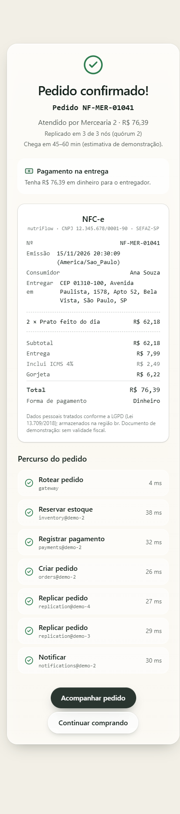 | 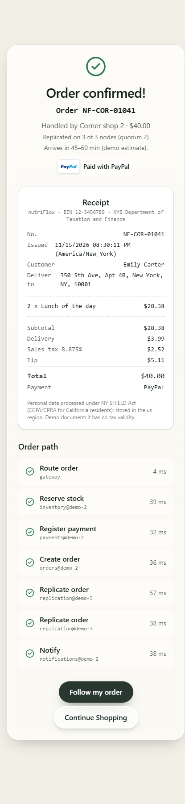 | 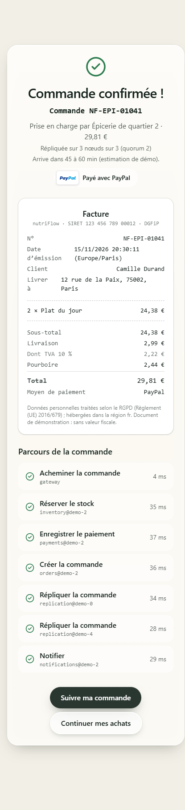 | 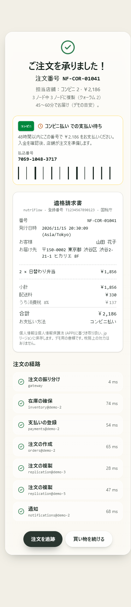 |

Las capturas del carrito están en el Anexo B.2 y las diferencias de formato, en el Anexo B.5. Se tomaron en otra tienda del barrio, con otra lista de precios, así que los totales no son los de la sección 9.

**Consideraciones culturales.** Naranja y verde se leen como frescura y aprobación en los cinco países, y el rojo queda para los errores. En Japón la confirmación usa un círculo, porque allí el ✓ puede marcar un error; además se evita el blanco puro y la propina no aparece. En Estados Unidos la propina viene sugerida. No usamos íconos de manos, porque el gesto de "OK" ofende en Brasil. Cada país ve primero sus medios de pago, con su marca.

## 7. Diseño físico

### 7.1 Red y nube

Usamos una nube híbrida. Colombia va en nube privada: un centro de datos alquilado en Bogotá, con una segunda zona unida por fibra. La escogimos porque AWS no tiene región en Colombia y decidimos que los datos no salgan del país. Los otros cuatro países van en nube pública (AWS), en una región de su propio país con dos zonas. Un núcleo sin datos personales recibe salud y métricas: Colombia llega por VPN y los demás por enlace privado del proveedor, y no hay enlaces de país a país. En modelos de servicio, CDN, DNS, pagos y mensajería son SaaS; aplicación y base de datos son PaaS; el intermediario y los servidores de Colombia son IaaS (Anexo C.9).

**Topología general**

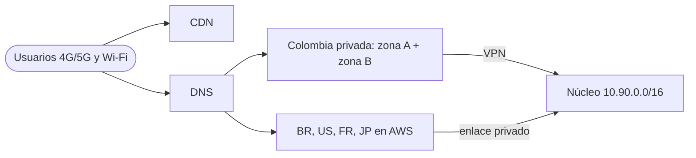

**Topología de Colombia**

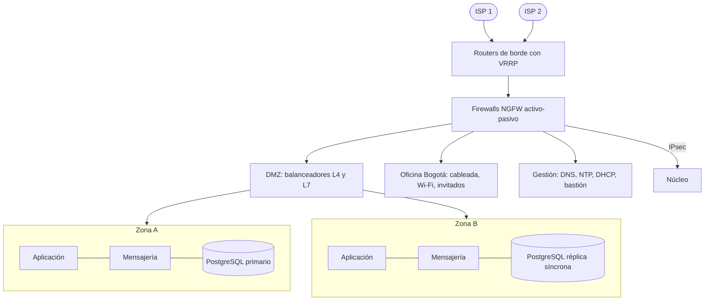

En AWS cada país sigue el mismo patrón con servicios administrados: Internet Gateway, balanceadores ALB y NLB, subredes por zona de disponibilidad y Transit Gateway hacia el núcleo.

### 7.2 Direccionamiento, DNS, DHCP y NTP

Cada país tiene un rango privado /16 (RFC 1918) que no se solapa con los demás: CO 10.10.0.0/16, BR 10.20, US 10.30, FR 10.40, JP 10.50 y el núcleo 10.90.0.0/16. Solo tienen IP pública los balanceadores de la DMZ, la salida a internet (NAT) y la pasarela VPN. Colombia usa VLSM, asignando primero las redes más grandes:

**VLSM de Colombia**

| Segmento (VLAN) | Hosts | Red | Rango utilizable | Broadcast | Útiles |
|---|---|---|---|---|---|
| Oficina, cableada (100) | 400 | 10.10.0.0/23 | 10.10.0.1 – 10.10.1.254 | 10.10.1.255 | 510 |
| Oficina, Wi-Fi corporativo (110) | 200 | 10.10.2.0/24 | 10.10.2.1 – 10.10.2.254 | 10.10.2.255 | 254 |
| App, zona A (20) | 100 | 10.10.3.0/25 | 10.10.3.1 – 10.10.3.126 | 10.10.3.127 | 126 |
| App, zona B (21) | 100 | 10.10.3.128/25 | 10.10.3.129 – 10.10.3.254 | 10.10.3.255 | 126 |
| Wi-Fi invitados (120, aislada) | 100 | 10.10.4.0/25 | 10.10.4.1 – 10.10.4.126 | 10.10.4.127 | 126 |
| DMZ, zona A (10) | 25 | 10.10.4.128/27 | 10.10.4.129 – 10.10.4.158 | 10.10.4.159 | 30 |
| DMZ, zona B (11) | 25 | 10.10.4.160/27 | 10.10.4.161 – 10.10.4.190 | 10.10.4.191 | 30 |
| Mensajería, zona A (30) | 20 | 10.10.4.192/27 | 10.10.4.193 – 10.10.4.222 | 10.10.4.223 | 30 |
| Mensajería, zona B (31) | 20 | 10.10.4.224/27 | 10.10.4.225 – 10.10.4.254 | 10.10.4.255 | 30 |
| Gestión: DNS, NTP, DHCP, bastión, monitoreo (50) | 25 | 10.10.5.0/27 | 10.10.5.1 – 10.10.5.30 | 10.10.5.31 | 30 |
| Datos PostgreSQL, zona A (40) | 12 | 10.10.5.32/28 | 10.10.5.33 – 10.10.5.46 | 10.10.5.47 | 14 |
| Datos PostgreSQL, zona B (41) | 12 | 10.10.5.48/28 | 10.10.5.49 – 10.10.5.62 | 10.10.5.63 | 14 |
| VPN y tránsito (60) | 10 | 10.10.5.64/28 | 10.10.5.65 – 10.10.5.78 | 10.10.5.79 | 14 |
| Routers (VRRP) ↔ firewalls, zona A | 5 | 10.10.5.80/29 | 10.10.5.81 – 10.10.5.86 | 10.10.5.87 | 6 |
| Routers (VRRP) ↔ firewalls, zona B | 5 | 10.10.5.88/29 | 10.10.5.89 – 10.10.5.94 | 10.10.5.95 | 6 |
| Enlace zona A ↔ zona B (fibra oscura) | 2 | 10.10.5.96/30 | 10.10.5.97 – 10.10.5.98 | 10.10.5.99 | 2 |
| Enlace oficina ↔ zona A | 2 | 10.10.5.100/30 | 10.10.5.101 – 10.10.5.102 | 10.10.5.103 | 2 |

Los tramos entre routers y firewalls son /29 porque con VRRP necesitan al menos cinco direcciones: dos routers, la IP virtual y el par de firewalls. Los enlaces punto a punto reales usan /30.

- **IPv6** (Colombia): un /48 por sitio y un /64 por red. En los enlaces se reserva un /64 y se configura un /127 (RFC 6164). Datos y gestión usan direcciones locales únicas (Anexo C.1). Las oficinas reciben IPv6 por SLAAC con RDNSS.
- **DNS:** `nutriflow.com.co`, `.com.br`, `.com`, `.fr` y `.jp`, con los registros del Anexo C.2. La zona se firma con DNSSEC en un primario oculto y se transfiere a dos proveedores, para no depender de uno. Los nombres `api`, `mqtt` y `pay-cb` tienen TTL de 30 s y pasan a la zona B si falla el chequeo de salud. Cada país tiene además una zona privada.
- **DHCP** en las oficinas (Anexo C.4). Los servidores llevan dirección fija asignada desde el IPAM; en AWS reciben la suya por el DHCP de la VPC, que también les entrega el DNS interno y el NTP del proveedor.
- **NTP:** las fuentes públicas de cada país alimentan dos servidores de hora por país, y todos los equipos se sincronizan con esos dos (Anexo C.5).

### 7.3 Puertos, protocolos, TCP y UDP

**Puertos principales**

| Servicio | Protocolo | Puerto | Transporte |
|---|---|---|---|
| Web y API | HTTPS (HTTP/2, TLS 1.3) | 443 | TCP |
| Web y API en HTTP/3 | QUIC | 443 | UDP |
| Mensajería con TLS | MQTT sobre TLS | 8883 | TCP |
| Posición del repartidor | MQTT sobre QUIC | 14567 | UDP |
| Base de datos y su replicación | PostgreSQL | 5432 | TCP |
| DNS | DNS | 53 | UDP y TCP |
| Hora | NTP | 123 | UDP |
| VPN | IPsec IKEv2 y NAT-T | 500 y 4500 | UDP |
| Correo saliente | SMTP *submission* | 587 | TCP |
| Administración | SSH, solo por el bastión | 22 | TCP |
| Direccionamiento de oficinas | DHCP | 67 y 68 | UDP |

La tabla completa, con monitoreo, registros y directorio, está en el Anexo C.6. El pago va por TCP con TLS porque no puede perderse, duplicarse ni llegar en desorden. La posición del repartidor va por QUIC, que corre sobre UDP, por dos razones. QUIC mantiene la conexión cuando el teléfono pasa de 4G a Wi-Fi y cambia de IP. Y cada flujo de QUIC es independiente, así que una posición perdida no frena los mensajes de pedidos, como sí pasaría en una sola conexión TCP. QUIC sí retransmite dentro de cada flujo; si quisiéramos descartar las posiciones viejas sin retransmitirlas, usaríamos datagramas QUIC (RFC 9221). En el prototipo la posición viaja por TCP 1883 con QoS 0, sin confirmación a nivel de MQTT.

### 7.4 Equipos, medios y seguridad

Usamos routers de borde redundantes con dos proveedores de internet, firewalls de nueva generación, switches de centro de datos y de acceso, balanceadores y access points Wi-Fi 6 (Anexo C.9). Los medios guiados son fibra óptica y cable de cobre; los no guiados, el Wi-Fi y las redes 4G/5G de los usuarios. Cada país está dividido en zonas (borde, DMZ, aplicación, datos, mensajería, gestión, oficinas) y entre ellas todo lo que no está permitido se bloquea (Anexo C.8). Hay firewalls en tres capas, VPN con doble factor para administrar, TLS 1.3 en todo con certificados internos para los servicios, permisos por país en el intermediario y un filtro de aplicación con límite de peticiones por usuario (Anexo C.10). El prototipo corre en una sola máquina para la demostración y no debe exponerse a una red compartida.

### 7.5 Modelo de capas

| OSI | TCP/IP | Componentes |
|---|---|---|
| 7 Aplicación | Aplicación | Apps, API REST, eventos en vivo, MQTT, DNS, NTP, DHCP; filtro de aplicación y balanceador L7 |
| 6 Presentación | Aplicación | JSON en UTF-8; cifrado TLS 1.3 sobre TCP |
| 5 Sesión | Aplicación | Sesión TLS, conexión HTTP/2 reutilizada, sesión persistente de MQTT |
| 4 Transporte | Transporte | TCP, UDP y QUIC (con QUIC, TLS va integrado en el transporte); balanceador L4 |
| 3 Red | Internet | IPv4, IPv6, IPsec; routers y firewalls |
| 2 Enlace, 1 Física | Acceso a la red | Ethernet, Wi-Fi, 4G/5G, VLAN, switches, access points; fibra y cobre |

## 8. Prototipo y pruebas

El prototipo tiene cinco regiones, una por país, cada una con su propia base de datos, más una segunda instancia de Colombia, el intermediario de mensajes y los servicios de Pagos, Logística y Notificaciones. Con la app web son once procesos independientes que se comunican por red. Las cinco regiones ejecutan el mismo código y lo que cambia entre ellas es el perfil de cada país. Se levanta con Docker Compose, un contenedor por proceso (`npm run demo`), o como procesos de Node sin Docker (`npm run demo:local`). Cada ventana de la app se conecta solo a la región de su país, y la cabecera muestra la instancia que la atiende. Los datos de prueba son ficticios.

Hay dos formas de verlo. La plataforma distribuida es la que se levanta localmente con procesos o contenedores, y es la que se usa en la demostración y en las pruebas de falla. La versión publicada en Vercel es un modo de navegador que simula los nodos dentro de la página: sirve para recorrer la interfaz desde cualquier teléfono, pero no es el sistema distribuido.

**Tecnologías.** Node.js en el servidor, SQLite como base de datos de cada región, Aedes como intermediario MQTT, React con Vite y Tailwind CSS en la app web, Leaflet con OpenStreetMap para los mapas y Docker Compose para los contenedores. Las pruebas usan Vitest en la app y el ejecutor de pruebas de Node en la plataforma. Todas son libres. Las escogimos porque nos permiten usar un solo lenguaje en el navegador y en el servidor, de modo que las reglas del pedido y los precios son los mismos en los dos lados, y porque no requieren licencias (Anexo D.3).

**Pruebas de falla.** Una batería automática levanta la plataforma real y detiene procesos de forma intencional; las 12 pruebas pasan. Entre otras cosas, comprueban que un pago espera en la cola mientras Pagos está caído y se completa al volver, que cancelar con el cobro en camino termina en reembolso, que si cae la región primaria atiende la réplica sin duplicar pedidos, que un pedido espera repartidor mientras Logística está caída y que el intermediario anuncia cada caída (Anexo D.1). La app tiene además 113 pruebas automáticas, entre ellas las del caso de la sección 9 en los cinco países (Anexo D.2). La demostración en vivo sigue el guion del Anexo D.4.

**Lo que no hace el prototipo.** El carrito se modifica libremente antes de pagar; después de pagar, el pedido solo se puede cancelar (con reembolso) y volver a hacer, no editar. El rol se elige sin contraseña. Estas y las demás limitaciones están en el Anexo A.2.

## 9. Caso de prueba obligatorio

Es el caso de la sección 8 del enunciado: dos almuerzos, un domicilio y una propina, a las 20:30 locales del 15 de noviembre de 2026. Una prueba automática verifica estos valores en los cinco países.

**Resultado del caso de prueba en los cinco países**

| | Colombia | Brasil | Estados Unidos | Francia | Japón |
|---|---|---|---|---|---|
| Idioma y estados | es: Recibido → Entregado | pt: Recebido → Entregue | en: Placed → Delivered | fr: Reçue → Livrée | ja: 受付済み → 配達完了 |
| Subtotal | $ 37.800 | R$ 65,80 | $29.98 | 25,80 € | ￥1,960 |
| Domicilio | $ 5.900 | R$ 7,99 | $3.99 | 2,99 € | ￥330 |
| Impuesto | INC 8 %, $ 2.800 incluido | ICMS 4 %, R$ 2,63 incluido | 8,875 %, $2.66 sumado | TVA 10 %, 2,35 € incluida | 消費税 8 %, ￥145 incluido |
| Propina | $ 3.780 (10 %, opcional) | R$ 6,58 (10 %, opcional) | $5.40 (18 %, sugerida) | 2,58 € (10 %, opcional) | No aparece |
| **Total** | **$ 47.480** | **R$ 80,37** | **$42.03** | **31,37 €** | **￥2,290** |
| Fecha y hora local | 15/11/2026 08:30 p. m. | 15/11/2026 20:30 | 11/15/2026 08:30 PM | 15/11/2026 20:30 | 2026/11/15 20:30 |
| Guardado en UTC | 16/11 01:30 | 15/11 23:30 | 16/11 01:30 | 15/11 19:30 | 15/11 11:30 |
| Dirección y teléfono | Calle 72 # 10-34; 300 123 4567 | CEP 01310-200, Av. Paulista, 1578; (11) 91234-5678 | 350 5th Ave, New York, NY 10118; (212) 555-0123 | 12 rue de la Paix, 75002 Paris; 06 12 34 56 78 | 〒150-0002 東京都渋谷区…; 090-1234-5678 |
| Comprobante | Factura electrónica (DIAN) | NFC-e (SEFAZ-SP) | Receipt | Facture | 適格請求書 |
| Medios de pago | Nequi, PSE, tarjeta, Daviplata, efectivo | Pix, tarjeta, boleto, efectivo | Tarjeta, Apple/Google Pay, ACH, PayPal | Tarjeta, Apple Pay, SEPA, PayPal | Tarjeta, PayPay, konbini |

Las diferencias entre columnas salen del perfil de cada país; el código que calcula el pedido es el mismo en las cinco regiones. El impuesto se calcula sobre los almuerzos y el domicilio se trata como no gravado, una simplificación que documentamos en el Anexo A.2. El 15 de noviembre es festivo en Brasil (Proclamação da República) y la app lo avisa.

## 10. Fuentes y uso de IA

Las fuentes oficiales de cada país, las referencias técnicas y la declaración completa de uso de IA están en el Anexo E. Usamos Claude Code (Anthropic) para escribir código, redactar borradores y revisar decisiones con un grupo de agentes revisores. Nosotros tomamos las decisiones, revisamos el resultado, corrimos las pruebas y respondemos por todo el contenido.

# Anexos

## Anexo A. Diseño funcional

### A.1 Comparación de middleware

**Comparación con las alternativas vistas en clase** (1 = débil, 5 = fuerte):

| Criterio | MQTT | AMQP (RabbitMQ) | Kafka | gRPC | REST |
|---|---|---|---|---|---|
| Publicación-suscripción nativa | 5 | 5 | 4 | 2 | 1 |
| Persistencia y garantías de entrega | 4 (2 en el prototipo) | 5 | 5 | 1 | 1 |
| Apto para móvil y poco ancho de banda | 5 | 2 | 1 | 3 | 2 |
| Orden de mensajes | 3 | 3 | 5 | 4 | 1 |
| Volver a leer el historial | 1 | 2 | 5 | 1 | 1 |
| Costo de operarlo | 5 | 3 | 1 | 4 | 5 |
| Norma abierta | 5 | 4 | 2 | 3 | 5 |
| Clientes en muchos lenguajes | 5 | 5 | 4 | 5 | 5 |
| **Total (sobre 40)** | **33 (31 en el prototipo)** | **29** | **27** | **23** | **21** |

### A.2 Limitaciones del prototipo

| Punto débil | Estado | Remedio |
|---|---|---|
| Cancelar con el cobro en camino dejaba el pedido cancelado y cobrado | Corregido: cuando llega la aprobación, el pedido cancelado se reembolsa (tiene prueba automática) | |
| Reintentar un pedido en la réplica creaba un pedido duplicado | Corregido: el mismo pedido enviado otra vez devuelve el que ya existe (tiene prueba automática) | |
| Entre confirmar el pedido y publicar el mensaje no hay atomicidad: si el proceso muere justo ahí, el pedido queda esperando el pago | Pendiente | Patrón *transactional outbox* (Richardson, 2018): el mensaje se guarda en la misma transacción y se publica después |
| Si el intermediario cae, las regiones no pueden confirmar los comandos que publican mensajes y la app agota su tiempo de espera; la cola en memoria se pierde | Pendiente | Un intermediario por país, en clúster y con persistencia en disco |
| La réplica de Colombia usa el mismo archivo de datos que el primario: protege de la caída del proceso, no de la pérdida del disco | Pendiente | Réplica síncrona de PostgreSQL en otra zona |
| Un cambio de estado reintentado en la réplica después de confirmarse responde 409, aunque el cambio ya se hizo | Pendiente | Tomar el 409 como éxito si el pedido ya está en el estado pedido, o una clave de idempotencia por comando |
| El reembolso no tiene acuse de recibo, y el reembolso tardío no genera aviso al cliente (solo cambia el estado del pago) | Pendiente | Un mensaje de confirmación del reembolso, un estado intermedio "reembolso solicitado" y su aviso |
| Pagos y Notificaciones usan una sola base para los cinco países | Pendiente | Una instancia de cada servicio por país, igual que el intermediario |
| Después de pagar, el pedido no se puede editar: solo cancelar con reembolso y volver a pedir | Pendiente | Modificar mientras está "Recibido", con cobro o reembolso de la diferencia |
| El domicilio no paga impuesto. En los cinco países sí lo paga (en Nueva York el total sería $42.38) | Pendiente | Un campo `tax.rates.delivery` en el perfil, con la tasa del servicio de cada país |
| El rol se elige sin contraseña | Pendiente | Proveedor de identidad (Anexo A.3) |

### A.3 Seguridad por amenaza

| Amenaza | Prototipo | Diseño objetivo |
|---|---|---|
| Suplantación de rol | Token firmado (HMAC-SHA256) con expiración; cada acción revisa el rol (un cliente no puede aceptar un pedido). La demo entrega un token por rol sin contraseña | Proveedor de identidad (OpenID Connect) con contraseña o código por SMS |
| Manipulación de precios | El servidor nunca acepta el precio que manda el navegador: lo recalcula con su lista, impuestos y propina | Igual |
| Robo de datos de tarjeta | El número de tarjeta no sale del teléfono: la pasarela recibe un token y solo se guardan los últimos cuatro dígitos | Tokenización de la pasarela real (PCI DSS) |
| Escucha en tránsito | La versión publicada va por HTTPS; la demostración local va sin cifrar | TLS 1.3 en todo, MQTT con TLS, VPN o enlace privado cifrado hacia el núcleo |
| Datos sensibles guardados | Los datos de prueba son ficticios | Cifrado en disco de la base de cada país y cifrado de teléfono y dirección |
| Denegación de servicio | Límite de tamaño de cada petición y validación de cada dato que llega | Límite de peticiones por usuario, firewall de aplicación y protección anti-DDoS del proveedor |
| Acceso a mensajes de otro país | Un solo intermediario sin permisos por país | Un intermediario por país, con permisos para que cada región solo lea y publique lo suyo |

### A.4 Modelo de ingresos

La plataforma gana en cada pedido entregado. Su ingreso principal es la comisión a la tienda, un porcentaje del subtotal de productos, igual que en Rappi e iFood. El cliente paga además una tarifa de domicilio, con la que la plataforma le paga al repartidor; desde cierto monto de compra el domicilio es gratis, para que valga la pena llenar la canasta. La publicidad dentro de la app (tienda destacada en el mapa) está prevista, pero el prototipo no la implementa. La propina no es ingreso porque va completa al repartidor.

Los valores viven en el perfil regional de cada país, y el administrador los cambia desde la consola sin desplegar código. Los porcentajes se guardan como enteros sobre 100 000 (15 % = `15000`) para no usar `float`. En Estados Unidos el 18 % se divide en 15 % por la entrega y 3 % por procesar el pago, los topes de Nueva York (NYC Admin. Code § 20-563.3).

**Comisión y domicilio por país, en moneda local y en dólares**

| País | Moneda | Comisión | Domicilio | Gratis desde | Domicilio en USD | Gratis desde en USD |
|---|---|---|---|---|---|---|
| Colombia | COP | 15 % | $ 5.900 | $ 90.000 | 1,51 | 23,08 |
| Brasil | BRL | 15 % | R$ 7,99 | R$ 120,00 | 1,48 | 22,22 |
| Estados Unidos | USD | 18 % | $3.99 | $35.00 | 3,99 | 35,00 |
| Francia | EUR | 17 % | 2,99 € | 30,00 € | 3,25 | 32,61 |
| Japón | JPY | 14 % | ￥330 | ￥3,500 | 2,17 | 23,03 |

*Tasas de referencia del prototipo: tabla fija del 1 de noviembre de 2026 (1 USD = 3 900 COP, 5,40 BRL, 0,92 EUR, 152 JPY). En vivo se usa ExchangeRate-API, que entrega la fecha de cada tasa.*

**Por qué los valores no son iguales en dólares.** Un domicilio de 4 dólares en Bogotá sería caro y nadie lo pagaría. Preferimos cobrar en cada ciudad lo que allí se paga por un mandado de 30 minutos, con la misma lógica de cálculo en todos los países. Por eso el domicilio gratis arranca en una canasta de unos 22 a 35 dólares, según el país. La comisión sube en Estados Unidos y Francia, donde operar (soporte, seguros, cumplimiento legal) cuesta más, y baja en Japón, donde el pedido promedio es más pequeño y los konbini compiten fuerte.

**Ingreso del pedido de prueba.** Con el pedido de la sección 9 (dos almuerzos, domicilio y propina), el ingreso bruto es comisión más domicilio. Como el domicilio pasa al repartidor, el margen de la plataforma es la comisión.

**Ingreso de la plataforma con el pedido de la sección 9**

| País | Subtotal | Comisión (margen) | Domicilio | Ingreso bruto | En USD |
|---|---|---|---|---|---|
| Colombia | $ 37.800 | $ 5.670 | $ 5.900 | $ 11.570 | 2,97 |
| Brasil | R$ 65,80 | R$ 9,87 | R$ 7,99 | R$ 17,86 | 3,31 |
| Estados Unidos | $29.98 | $5.40 | $3.99 | $9.39 | 9,39 |
| Francia | 25,80 € | 4,39 € | 2,99 € | 7,38 € | 8,02 |
| Japón | ￥1,960 | ￥274 | ￥330 | ￥604 | 3,97 |

La consola de administración hace esta misma suma con los pedidos reales y la consolida en dólares. El cobro al cliente siempre es en su moneda; el dólar solo sirve para el reporte.

### A.5 Qué pasa cuando cae cada proceso

| Se cae | Qué pasa | Verificado |
|---|---|---|
| Región primaria de Colombia | La app pasa a la réplica y el siguiente paso sale bien | Prueba automática de fallas |
| Pagos | El cobro espera en la cola; la tienda no puede aceptar un pedido sin pagar; al volver Pagos, el pedido sigue | Prueba automática de fallas |
| Logística | El pedido espera listo; al volver, Logística toma la lista pendiente y asigna | Prueba automática de fallas |
| Notificaciones | El intermediario anuncia la caída y la consola la muestra. Al volver, los avisos se ponen al día desde su sesión persistente | El aviso de caída y de vuelta, con prueba automática; la puesta al día, por la sesión persistente, sin prueba propia |
| Intermediario de mensajes | Las regiones no pueden confirmar comandos que publican mensajes y la app agota su tiempo de espera; la cola en memoria se pierde | Limitación del prototipo (Anexo A.2) |
| Una tienda (modo de navegador) | Reintento con espera creciente, corte de llamadas a un nodo caído y lectura desde una réplica | Pantalla de estado del sistema |

## Anexo B. Localización

### B.1 Perfil regional completo

| Atributo (campo del perfil) | Colombia | Brasil | Estados Unidos | Francia | Japón |
|---|---|---|---|---|---|
| Idioma, locale (`language`, `locale`) | es, es-CO | pt, pt-BR | en, en-US | fr, fr-FR | ja, ja-JP |
| Moneda y decimales (`currency`, `minorUnits`) | COP, 0 | BRL, 2 | USD, 2 | EUR, 2 | JPY, 0 |
| Zona horaria (`timeZone`) | America/Bogota | America/Sao_Paulo | America/New_York | Europe/Paris | Asia/Tokyo |
| Reloj (`hour12`) | 12 h | 24 h | 12 h | 24 h | 24 h |
| Primer día de la semana (`firstDayOfWeek`) | domingo | domingo | domingo | lunes | domingo |
| Medidas (`measurement`) | métrico | métrico | imperial (millas) | métrico | métrico |
| Teléfono (`phone`) | +57, 300 123 4567 | +55, (11) 91234-5678 | +1, (212) 555-0123 | +33, 06 12 34 56 78 | +81, 090-1234-5678 |
| Código postal (`postalCode`) | 6 dígitos, opcional | CEP 01310-200 | ZIP 10118 (+4 opcional) | 5 dígitos | 〒150-0002 |
| Campos de dirección (`address.fields`) | vía y número, barrio, ciudad, código postal opcional | CEP, rua, número, complemento, bairro, cidade, estado | número y calle, apto, ciudad, estado, ZIP | número y calle, código postal, ciudad | 〒, prefectura, ciudad, chōme-ban-gō, edificio |
| Orden del nombre (`nameOrder`) | nombre + apellido | nome + sobrenome | first + last | prénom + nom | **apellido + nombre** |
| Impuesto (`tax`) | INC 8 % en comidas, IVA 19 % / 5 %, incluido | ICMS 4 % en comidas (régimen especial), 18 % / 7 %, incluido, "por dentro" | Sales tax 8,875 %, **sumado** | TVA 10 % en comidas, 20 % / 5,5 %, incluida | 消費税 8 % en comidas, 10 %, incluido |
| Comprobante (`receipt`) | Factura electrónica de venta (DIAN) | NFC-e (SEFAZ-SP) | Receipt | Facture | 適格請求書 (インボイス) |
| Identificación fiscal (`fiscalId`) | CC / NIT | CPF / CNPJ | EIN | SIRET | 法人番号 / 登録番号 T + 13 dígitos |
| Medios de pago (`payments`) | Nequi, PSE, tarjeta, Daviplata, efectivo | Pix, tarjeta, boleto, efectivo | tarjeta, Apple Pay, Google Pay, ACH, PayPal | tarjeta (CB), Apple Pay, SEPA, PayPal | tarjeta, PayPay, konbini |
| Propina (`tip`) | opcional, 5 % o 10 %, sin preselección | opcional, 5 % o 10 % | **sugerida**, 15 / 18 / 20 %, preseleccionada 18 % | opcional, sin preselección | **ninguna**: la app no la muestra |
| Festivos 2026 (`holidays`) | 18, con los trasladados a lunes (Ley 51 de 1983) | 13: nacionales, del estado y de la ciudad de São Paulo | 11 federales | 11 nacionales | 18, incluidos los días de sustitución y la Semana Dorada |
| Protección de datos (`dataProtection`) | Ley 1581 de 2012, SIC | LGPD (Lei 13.709/2018), ANPD | NY SHIELD Act (CCPA/CPRA para residentes de California) | RGPD, CNIL | APPI (個人情報保護法), PPC |
| Fuentes (`sources`) | CLDR, DIAN, SIC, MinTrabajo | CLDR, SEFAZ-SP, Planalto, ANPD | CLDR, NYS Tax, OPM, NY AG | CLDR, impots.gouv.fr, CNIL, service-public.fr | CLDR, 国税庁, 内閣府, PPC |

### B.2 Capturas del carrito

Las capturas del carrito y del comprobante (este último en la sección 6) se tomaron en otra tienda del barrio, con propina del 10 % donde es opcional. Cada tienda tiene su lista de precios: en Bogotá el almuerzo cuesta $ 17.900 allí y $ 18.900 en la tienda del caso de prueba. Por eso los totales difieren de la sección 9, pero el formato, el impuesto, el comprobante y la propina son los mismos.

**Carrito**

| Colombia | Brasil | Estados Unidos | Francia | Japón |
|---|---|---|---|---|
| 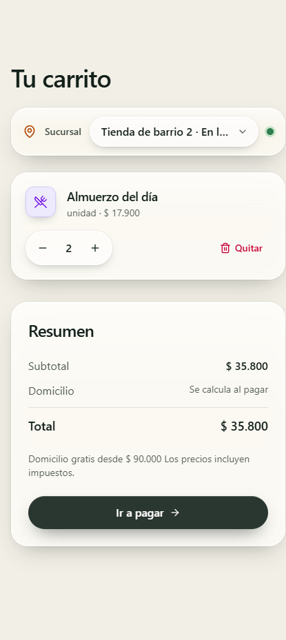 | 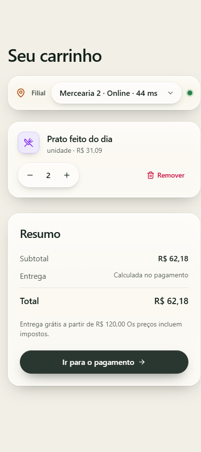 | 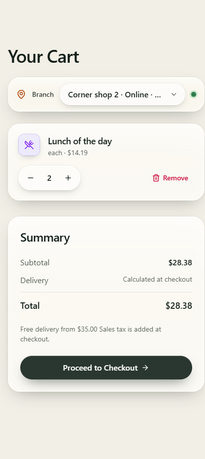 | 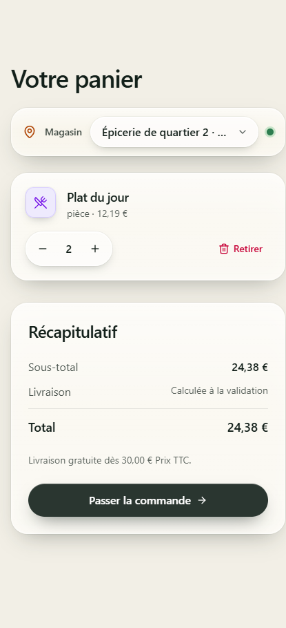 | 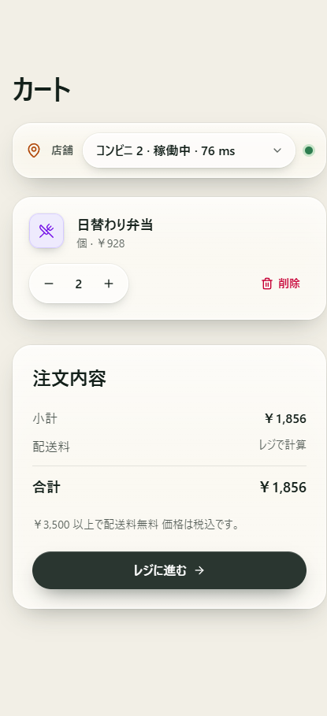 |

### B.3 Las diez reglas de localización

| Regla del enunciado (4.1) | Cómo se cumple |
|---|---|
| 1. UTF-8 en toda la cadena | Páginas, mensajes entre procesos, base de datos y archivos en UTF-8; los datos de prueba usan ñ, tildes, ç, œ y japonés |
| 2. Textos fuera del código, con respaldo | Un catálogo de textos por idioma con claves estables; si falta una traducción se muestra el inglés |
| 3. Números, monedas y fechas con biblioteca CLDR | Todo se formatea con la API `Intl` del navegador según el país, incluidas las distancias (millas en Estados Unidos) |
| 4. Dinero como entero | Todo importe es un entero en la unidad menor de la moneda; COP y JPY se manejan en pesos y yenes enteros, sin decimales. Las tasas también son enteros |
| 5. Tiempo en UTC, mostrado en la zona del usuario | Se guarda en UTC y se muestra en la zona del país, con horario de verano en Nueva York y París; relojes con NTP |
| 6. Conversión de monedas con fuente y fecha | Servicio de tasas con fuente y fecha, y una tabla de respaldo; solo para el consolidado del administrador |
| 7. Direcciones, teléfonos y nombres por país | Campos y orden de dirección, formato de teléfono y código postal, y orden del nombre definidos en el perfil; en Japón primero el apellido |
| 8. Tipografía y longitud del texto | Fuentes japonesas y reglas de corte de línea japonesas; ningún botón con ancho fijo, para el francés y el portugués |
| 9. Impuestos, comprobante y propina configurables | Son campos del perfil, editables desde la consola de administración |
| 10. Cumplimiento legal de datos | Anexo B.4 |

### B.4 Protección de datos por país

| País | Ley | Dónde residen los datos | Cómo se respeta |
|---|---|---|---|
| Colombia | Ley 1581 de 2012 (SIC) | Región de Colombia | Consentimiento al registrarse. La ley permite transferir a países con nivel adecuado (art. 26); guardar los datos en el país es una decisión nuestra, más estricta |
| Brasil | LGPD, Lei 13.709/2018 (ANPD) | Región de Brasil | Base legal "ejecución de contrato" para el pedido; consentimiento para mercadeo; derecho de eliminación |
| Estados Unidos | NY SHIELD Act; CCPA/CPRA para residentes de California | Región de Estados Unidos | Aviso de brecha y medidas razonables de seguridad; derecho a saber y a borrar para residentes de California |
| Francia | RGPD (Reglamento UE 2016/679, CNIL) | Región de Francia (dentro de la UE) | Base legal: ejecución del contrato para el pedido (art. 6.1.b) y consentimiento para mercadeo y cookies; derecho de supresión (art. 17); transferencias fuera de la UE solo con las garantías del capítulo V |
| Japón | APPI (個人情報保護法, PPC) | Región de Japón | Propósito de uso informado; consentimiento para dar datos a terceros en el extranjero |

### B.5 Diferencias visibles entre las capturas

| Qué se ve | Colombia | Brasil | Estados Unidos | Francia | Japón |
|---|---|---|---|---|---|
| Documento | Factura electrónica de venta (DIAN) | NFC-e (SEFAZ-SP) | Receipt | Facture | 適格請求書 |
| Fecha y hora de emisión | 15/11/2026 08:30:09 p. m. | 15/11/2026 20:30:09 | 11/15/2026 08:30:11 PM | 15/11/2026 20:30:11 | 2026/11/15 20:30:09 |
| Moneda | $ 45.280 (sin decimales, punto de miles) | R$ 76,39 | $40.00 | 29,81 € (símbolo después) | ￥2,186 (sin decimales) |
| Impuesto | Incluye INC 8 % | Inclui ICMS 4 % | Sales tax 8,875 % **sumado** | Dont TVA 10 % | うち消費税 8% |
| Propina | Opcional, 10 % elegido | Opcional, 10 % elegido | **Sugerida**, 18 % ya marcado | Opcional, 10 % elegido | **No aparece** |
| Dirección | Calle 72 # 10-34, Chapinero, Bogotá | CEP primero, rua, número, complemento, bairro, cidade, estado | número y calle, apto, ciudad, estado, ZIP | número y calle, código postal, ciudad | 〒, prefectura, ciudad, barrio, edificio, sin comas |
| Nombre | Laura Gómez Peña | Ana Souza | Emily Carter | Camille Durand | 山田 花子 (apellido primero) |
| Medio de pago | Efectivo (también Nequi, PSE, Daviplata, tarjeta) | Dinheiro (también Pix, boleto, tarjeta) | PayPal (también tarjeta, Apple Pay, Google Pay, ACH) | PayPal (también tarjeta, Apple Pay, SEPA) | コンビニ払い con número de pago (también tarjeta, PayPay) |
| Aviso de festivo | No | **Sí**: Proclamação da República | No | No | No |

### B.6 Consistencia por tipo de dato

| Dato | Consistencia | Razón |
|---|---|---|
| Estado del pedido y asignación de repartidor | Fuerte: un escritor por país, transacción ACID y réplica síncrona en el diseño objetivo | Dos versiones de quién lleva el pedido no se pueden reconciliar después |
| Pago | Fuerte dentro de Pagos; eventual entre Pagos y la región, coordinado por la saga | Mientras llega el resultado, el pedido queda "esperando pago" y la tienda no puede aceptarlo |
| Notificaciones | Eventual | Un aviso que llega dos segundos tarde no hace daño |
| Flota y posición del repartidor | Eventual (QoS 0) | La siguiente posición corrige la anterior |
| Catálogo y precios en caché | Eventual | Cambian poco, y el precio final lo recalcula la región al crear el pedido |
| Perfil regional y tasas | Eventual (mensaje retenido) | El administrador cambia un valor y todos lo reciben en segundos |
| Consolidado del administrador | Eventual | Es un reporte, no una operación |

### B.7 Pantallas de las cuatro apps

**Apps del cliente, el comercio y el repartidor**

| Cliente (inicio) | Comercio (pedidos de la tienda) | Repartidor (entregas) |
|---|---|---|
| 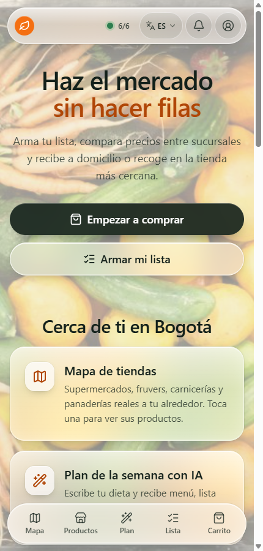 | 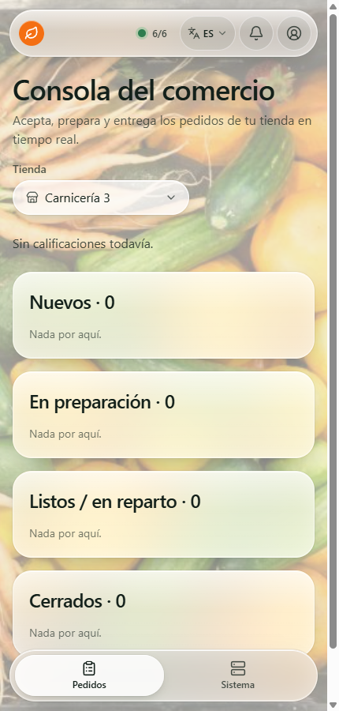 | 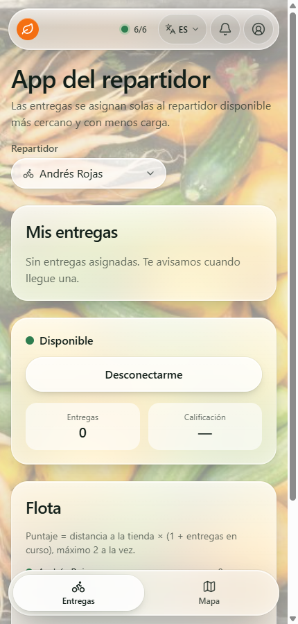 |

**Consola del administrador**

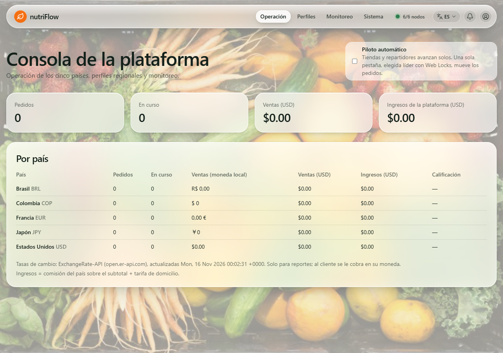

## Anexo C. Diseño físico

### C.1 IPv6 de Colombia

| Sitio / subred | Prefijo |
|---|---|
| Zona A (/48) | 2001:db8:10::/48 |
| Zona B (/48) | 2001:db8:11::/48 |
| Oficina Bogotá (/48) | 2001:db8:12::/48 |
| DMZ A / App A / Mensajería A | 2001:db8:10:10::/64 · 2001:db8:10:20::/64 · 2001:db8:10:30::/64 |
| DMZ B / App B / Mensajería B | 2001:db8:11:11::/64 · 2001:db8:11:21::/64 · 2001:db8:11:31::/64 |
| Oficina cableada / Wi-Fi corporativo / invitados | 2001:db8:12:100::/64 · 2001:db8:12:110::/64 · 2001:db8:12:120::/64 |
| Enlaces punto a punto | Un /64 reservado por enlace y configurado como /127 (RFC 6164): 2001:db8:10:ff01::/64, :ff02::/64… en la zona A; los de la zona B salen de su propio /48 |
| Datos y gestión (solo internas, ULA RFC 4193) | fd3a:9c1e:7b20::/48 → :40::/64 (datos A), :41::/64 (datos B), :50::/64 (gestión). Los servidores de hora y DNS de gestión salen a internet por IPv4 con NAT |

Aplicación y mensajería tienen direcciones globales, pero no son alcanzables desde internet: el firewall solo deja entrar a la DMZ.

### C.2 Registros de la zona nutriflow.com.co

| Nombre | Tipo | Valor | TTL |
|---|---|---|---|
| `@` | SOA | `ns0.nutriflow.com. hostmaster.nutriflow.com. 2026111501 7200 900 1209600 300` | 3600 |
| `@` | NS | `ns1…`, `ns2…` (proveedor A), `ns3…`, `ns4…` (proveedor B) | 172800 |
| `@` | A / AAAA | Direcciones anycast del CDN (la web estática). ALIAS no es un tipo estándar y no viaja por transferencia de zona, así que usamos registros A/AAAA | 300 |
| `www` | CNAME | `<distribución>.cloudfront.net.` | 3600 |
| `api` | A / AAAA | 203.0.113.2 / 2001:db8:10:10::10 (VIP del balanceador L7, zona A). Registro de conmutación: respaldo 203.0.113.3 / 2001:db8:11:11::10 en la zona B del mismo país | **30** |
| `api` | HTTPS (SVCB, RFC 9460) | `1 . alpn="h3,h2"` | 300 |
| `mqtt` | A / AAAA | 203.0.113.4 / 2001:db8:10:10::20 (VIP del balanceador L4, puerto 8883 hacia el intermediario del país; respaldo 203.0.113.6 / 2001:db8:11:11::20), con conmutación igual a `api` | **30** |
| `_secure-mqtt._tcp` | SRV | `0 10 8883 mqtt.nutriflow.com.co.` | 300 |
| `pay-cb` | A / AAAA | 203.0.113.2 / 2001:db8:10:10::10, con respaldo 203.0.113.3 / 2001:db8:11:11::10 y conmutación igual a `api` (entrada de los avisos de la pasarela; la salida hacia ella sale por la NAT 203.0.113.5, que es la IP en su lista blanca) | **30** |
| `@` | MX | `10 mx1.nutriflow.com.`, `20 mx2.nutriflow.com.` | 3600 |
| `@` | TXT (SPF) | `v=spf1 include:<proveedor-correo> -all` | 3600 |
| `nf2026._domainkey` | TXT (DKIM) | `v=DKIM1; k=rsa; p=…` (clave RSA de 2048 bits, rotada cada año) | 3600 |
| `_dmarc` | TXT | `v=DMARC1; p=reject; rua=mailto:dmarc@nutriflow.com; adkim=s; aspf=s` | 3600 |
| `nutriflow.com.co._report._dmarc` (en la zona `nutriflow.com`) | TXT | `v=DMARC1` (autoriza a recibir los reportes de otra zona) | 3600 |
| `@` | CAA | `0 issue "letsencrypt.org"`, `0 issue "amazon.com"`, `0 iodef "mailto:security@nutriflow.com"` | 86400 |
| `@` | DS (en la zona padre) | Hash de la KSK, para DNSSEC | Lo fija el registro de .co |

La zona se firma con DNSSEC en el primario oculto `ns0` y se transfiere ya firmada (IXFR) a los dos proveedores.

### C.3 TTL por registro

| Registro | TTL | Razón |
|---|---|---|
| `api`, `mqtt`, `pay-cb` | 30 s | Tiempo de conmutación. Las consultas extra son baratas en anycast |
| Apex, HTTPS, SRV | 300 s | Estables, pero se pueden corregir rápido |
| MX, TXT, CNAME | 3600 s | Rara vez cambian |
| CAA | 86400 s | Solo cambia al cambiar de CA |
| NS | 172800 s | Delegación estable. El TTL de la delegación y del DS lo fija el registro de .co |
| Negativo (SOA) | 300 s | Un nombre nuevo aparece en 5 min |
| Zona interna | 60 s | Conmutación interna rápida |

### C.4 Ámbitos DHCP de la oficina de Bogotá

| Ámbito | Rango asignable | Exclusiones | Reservas | Concesión | Opciones |
|---|---|---|---|---|---|
| Cableada 10.10.0.0/23 | 10.10.0.21 – 10.10.1.250 | 10.10.0.1–.20 (puerta de enlace, switches), 10.10.1.251–.254 | Impresoras y pantallas, por MAC | 8 días | 3 = 10.10.0.1; 6 = 10.10.5.10, .11; 42 = 10.10.5.12, .13; 15 = corp.co.internal |
| Wi-Fi corporativo 10.10.2.0/24 | 10.10.2.21 – 10.10.2.250 | .1–.20 | Ninguna | 8 h | Las mismas, con 3 = 10.10.2.1 |
| Invitados 10.10.4.0/25 | 10.10.4.10 – 10.10.4.126 | .1–.9 | Ninguna | 1 h | 3 = 10.10.4.1; 6 = resolvedor público. Sin acceso a la red interna |

### C.5 Jerarquía NTP

| Estrato | Fuente |
|---|---|
| 0 | Relojes atómicos y GNSS de los institutos de metrología y de AWS |
| 1–3, externo | CO: `co.pool.ntp.org` y `time.cloudflare.com` (estrato 3, con NTS) · BR: `a.st1.ntp.br` (con NTS) · US: `time.nist.gov` · FR: `fr.pool.ntp.org` · JP: `ntp.nict.jp` · AWS: Amazon Time Sync, 169.254.169.123 (local en cada región). NTS solo se usa con las fuentes que lo soportan |
| 2–3, interno | Dos servidores chrony por país (CO: 10.10.5.12 y .13). Cada uno usa al menos 4 fuentes, y solo ellos pueden sacar UDP 123 a internet |
| 3–4, clientes | APIs, intermediarios, bases y PCs: `server ... iburst` contra los dos internos y `makestep 1.0 3` |

### C.6 Puertos y protocolos

| Servicio | Protocolo | Puerto | Transporte | Prototipo / objetivo | Justificación |
|---|---|---|---|---|---|
| Web (redirección) | HTTP/1.1 | 80 | TCP | Objetivo | Solo `301` a HTTPS y retos ACME |
| Web y API regional | HTTPS (HTTP/2, TLS 1.3) | 443 | TCP | Objetivo (prototipo: HTTP 4101–4105 y 4111) | Fiable y ordenado. HTTP/2 multiplexa en una conexión |
| Web y API en HTTP/3 | QUIC | 443 | UDP | Objetivo | Menos latencia en red móvil. Se anuncia con el registro HTTPS, y si UDP está bloqueado se usa TCP |
| Estado en vivo | SSE (`/stream`) | 443 | TCP | Ambos (prototipo: puerto de la región) | Flujo de solo bajada que necesita orden |
| Mensajería interna | MQTT 3.1.1 | 1883 | TCP | Solo prototipo | En el objetivo está cerrado y todo va por 8883 |
| Mensajería con TLS | MQTT sobre TLS | 8883 | TCP | Objetivo | QoS 1 para pagos, logística y notificaciones |
| Posición del repartidor | MQTT sobre QUIC (EMQX) | 14567 (valor por defecto de EMQX, configurable) | UDP | Objetivo (prototipo: QoS 0 sobre TCP 1883) | La conexión sobrevive al cambio de red y una pérdida en un flujo no frena a los demás. QUIC retransmite dentro de cada flujo; para descartar posiciones viejas se usarían datagramas QUIC (RFC 9221) |
| Puente país → núcleo | MQTT sobre TLS (mTLS) | 8883 | TCP | Objetivo | Solo `nf/system/health/#` y métricas, dentro del túnel VPN |
| Balanceador → API regional | HTTPS con mTLS | 8443 | TCP | Objetivo | El tráfico interno también va cifrado y autenticado |
| Base de datos | PostgreSQL | 5432 | TCP | Objetivo (prototipo: archivo SQLite, sin puerto) | Transacciones ACID |
| Replicación de la base | Streaming de PostgreSQL | 5432 | TCP | Objetivo | Réplica síncrona en otra zona del mismo país |
| Métricas | Prometheus / node exporter | 9090 / 9100 | TCP | Objetivo | Modelo *pull* por HTTP |
| Paneles | Grafana | 3000 | TCP | Objetivo | Solo detrás de la VPN |
| Registros (logs) | Syslog / Syslog sobre TLS | 514 / 6514 | UDP / TCP | Objetivo: 6514 entre zonas | 514/UDP solo en la LAN. Entre zonas del país, TLS. Al núcleo no van registros, solo alertas |
| Correo saliente | SMTP *submission* | 587 | TCP | Objetivo | Comprobantes, con STARTTLS y autenticación |
| Correo entrante / buzones | SMTP / IMAPS | 25 / 993 | TCP | Objetivo | MX / oficinas |
| DNS | DNS | 53 | UDP y TCP | Objetivo (prototipo: DNS de Docker o el directorio `directory.json`) | UDP para consultas; TCP para respuestas grandes con DNSSEC y para AXFR/IXFR |
| DNS cifrado | DoT | 853 | TCP | Objetivo | De los resolvers hacia afuera |
| Hora | NTP (chrony) | 123 | UDP | Objetivo | Un paquete de ida y uno de vuelta; un reintento no hace daño |
| Hora autenticada | NTS-KE | 4460 | TCP | Objetivo | Intercambio de claves con TLS para NTS (RFC 8915) |
| VPN de Colombia al núcleo | IPsec IKEv2 / NAT-T / ESP | 500 / 4500 / protocolo IP 50 | UDP / UDP / IP | Objetivo | Túneles hacia el núcleo |
| VPN (alternativa) | WireGuard | 51820 | UDP | Objetivo | Más simple de operar |
| Administración | SSH | 22 | TCP | Objetivo | Solo por el bastión, con llaves y sin contraseña |
| Direccionamiento | DHCP | 67 / 68 | UDP | Objetivo (oficinas) | Difusión antes de que el equipo tenga IP |
| Directorio y Wi-Fi de oficina | LDAPS / RADIUS | 636 / 1812–1813 | TCP / UDP | Objetivo (oficinas) | Identidad del personal y 802.1X |
| Push a teléfonos | APNs / FCM (HTTP/2) | 443 | TCP | Objetivo | La conexión la inicia el servidor de Notificaciones |
| Pasarela de pago | HTTPS (REST, idempotente) | 443 | TCP | Objetivo (prototipo: simulada por MQTT) | Fiabilidad y confidencialidad |

### C.7 Puertos del prototipo

| Proceso | Puerto | Transporte |
|---|---|---|
| Intermediario de mensajes | 1883 | TCP (MQTT) |
| Regiones de los cinco países | 4101 a 4105 | TCP (HTTP) |
| Réplica de Colombia | 4111 | TCP (HTTP) |
| App web | 4173 (Docker, `npm run demo`) o 5173 (`npm run demo:local`) | TCP (HTTP) |
| Pagos, Logística, Notificaciones | Sin puerto propio: solo hablan con el intermediario | No aplica |

### C.8 Matriz de flujos entre zonas

| Origen → Destino | Puerto | Decisión |
|---|---|---|
| Internet → Borde | TCP 443, UDP 443 (HTTP/3) | Permitido |
| Internet → origen de la web estática sin pasar por el CDN | TCP 443 | **Denegado** (el origen solo acepta los rangos del CDN) |
| Internet → DMZ (VIP de `api`, `mqtt` y `pay-cb`) | TCP 80 (solo redirección), TCP 443, UDP 443 | Permitido, con WAF y límite por IP |
| Borde → DMZ | TCP 443 | Permitido |
| Internet → DMZ, VIP de `mqtt` | TCP 8883; UDP 14567 (QUIC) | Permitido; el intermediario exige la credencial del cliente, porque detrás de CGNAT la IP no identifica al repartidor |
| DMZ → Aplicación | TCP 8443, con mTLS | Permitido |
| DMZ → Mensajería | TCP 8883; UDP 14567 | Permitido (el balanceador L4 lleva el MQTT de las apps al intermediario) |
| Aplicación → Mensajería | TCP 8883, con mTLS | Permitido |
| Aplicación → Datos | TCP 5432, con TLS | Permitido |
| DMZ, Oficinas o Internet → Datos | cualquiera | **Denegado** |
| Datos primario → réplica del mismo país | TCP 5432 | Permitido |
| Datos de un país → datos de otro país | cualquiera | **Denegado** |
| Mensajería → núcleo, por la VPN o el peering | TCP 8883 (puente MQTT) | Permitido, solo salud y métricas |
| Aplicación → pasarela de pago, tasas, mapas, push (APNs/FCM) y CA (ACME) | TCP 443, por un proxy de salida con lista blanca | Permitido |
| Aplicación → proveedor de correo | TCP 587 | Permitido |
| Gestión → internet (fuentes de hora y DNS) | UDP 123, TCP 4460, UDP/TCP 53, TCP 853 | Permitido, solo desde los servidores de hora y DNS |
| Todas → Gestión (registros) | TCP 6514 | Permitido |
| Aplicación → cualquier otro destino de Internet | cualquiera | **Denegado** |
| Bastión → zonas del país | TCP 22, TCP 443 | Permitido |
| Oficinas → Aplicación o Datos | cualquiera | **Denegado** (solo por VPN con MFA → bastión) |
| Todas → DNS y NTP internos | UDP/TCP 53, UDP 123 | Permitido |
| Gestión (Prometheus) → todas las zonas | TCP 9100 | Permitido |
| Relay DHCP de oficinas → servidores DHCP de gestión | UDP 67 | Permitido |
| Pasarela VPN ↔ núcleo | UDP 500, UDP 4500, ESP (IP 50) | Permitido |
| Cualquiera → cualquiera | cualquiera | **Denegado** (regla final) |

### C.9 Dispositivos y medios

| Dispositivo | Colombia (privada) | BR, US, FR, JP (AWS, administrado) |
|---|---|---|
| Router de borde | 2 por sitio con VRRP, BGP con dos ISP y terminación IPsec | Internet Gateway, NAT Gateway, Transit Gateway, VPN Gateway |
| Firewall | Par de NGFW activo-pasivo (IPS y filtro por aplicación) | Security Groups, NACL, AWS Network Firewall y WAF |
| Switches L3 | Núcleo *spine-leaf* de 25/100 GbE; en la oficina, un switch de distribución con las SVI y el *relay* DHCP | Router de la VPC |
| Switches L2 | Acceso PoE+ de 1 GbE con *uplink* de 10 GbE | No aplica |
| Balanceadores | L7 (HAProxy o NGINX): HTTPS y SSE con *idle timeout* alto. L4: MQTT 8883 TCP y QUIC por UDP | ALB (L7) y NLB (L4, con soporte UDP) |
| Access points | Wi-Fi 6 (802.11ax) en la oficina, WPA3-Enterprise con 802.1X; invitados en otra SSID | Igual en las oficinas |

Las tiendas aliadas usan su propio Wi-Fi o 4G; nutriFlow no administra esas redes.

**Medios guiados.** Entre zonas y hacia el ISP usamos fibra monomodo OS2 (10G-LR, kilómetros); dentro del centro de datos, fibra multimodo OM4 (25G-SR, hasta 100 m); y hasta los puestos y los access points, cable Cat6 (1 y 2,5 GbE, hasta 100 m). Entre continentes viajan los cables submarinos del proveedor.

**Medios no guiados y redes móviles de los usuarios.** Wi-Fi 6 (2,4 y 5 GHz), y 4G LTE y 5G NR de los operadores de cada país (CO: Claro, Movistar, Tigo; BR: Vivo, Claro, TIM; US: Verizon, AT&T, T-Mobile; FR: Orange, SFR, Bouygues, Free; JP: docomo, au, SoftBank, Rakuten). Las redes móviles condicionan el diseño en cuatro puntos:
- Por el CGNAT de los operadores, el servidor no puede abrir conexiones hacia el teléfono, así que siempre es el teléfono el que conecta, con *keepalive* MQTT de 30 a 60 s.
- Al cambiar de celda cambia la IP, y QUIC migra la conexión sin reconectar, siempre que el balanceador L4 enrute por el ID de conexión de QUIC.
- Con cobertura intermitente, la sesión persistente con QoS 1 guarda los mensajes hasta que el teléfono vuelve.
- Para gastar pocos datos, las posiciones son JSON cortos con QoS 0.

### C.10 Seguridad de la red

**Segmentación.** Cada país es una red aislada y dividida en zonas. Cada zona interna es una subred (sección 7.2) con su propio grupo de seguridad:
- Internet: usuarios en redes fijas y móviles.
- Borde: CDN anycast con WAF y protección anti-DDoS.
- DMZ: balanceadores HTTPS y MQTT. Es la única zona que recibe conexiones desde internet; además de sus VIP, solo tienen IP pública la NAT de salida y la pasarela VPN.
- Aplicación: API regional, Pagos, Logística y Notificaciones.
- Datos: PostgreSQL primario y réplica, en dos zonas del país.
- Mensajería: el intermediario del país.
- Gestión: bastión, monitoreo, registros, PKI y secretos.
- Oficinas: cableado y Wi-Fi del personal.
- Tránsito VPN: la pasarela IPsec del país.

La matriz de flujos permitidos y denegados entre zonas (25 reglas, con denegación por defecto) está en el Anexo C.8.

**Firewalls en tres capas**, todas con denegación por defecto, para que si una falla la siguiente detenga el tráfico. La primera es un NGFW perimetral con inspección de estado e IPS. La segunda son los grupos de seguridad por instancia (con estado) y las NACL por subred (sin estado). La tercera es un firewall de host (`nftables`) que solo abre el puerto del servicio.

**VPN entre países.** Colombia tiene un túnel IPsec IKEv2 *site-to-site* hacia el núcleo, con AES-256-GCM, PFS y autenticación por certificado. BR, US, FR y JP usan *peering* de Transit Gateway, que AWS cifra en su red troncal. La topología es en estrella, sin túneles directos entre países. Por el túnel y el *peering* solo cruzan el puente MQTT de salud y métricas (`nf/system/health/#`) y el acceso administrativo; ningún dato personal. El consolidado del administrador viaja como agregados por país. El puente va además con mTLS, porque el túnel no reemplaza a TLS.

**Administración remota.** El operador entra por VPN de usuario con doble factor, llega al bastión y desde ahí abre SSH con certificados de 8 horas. Ningún servidor tiene SSH expuesto a internet, y cada sesión queda grabada.

**TLS y certificados.** Usamos TLS 1.3 en todo, y TLS 1.2 con suites AEAD solo en el borde, para clientes antiguos. Los nombres públicos tienen certificados de una CA pública emitidos por ACME (Let's Encrypt) o por la CA del proveedor, con renovación automática y una alerta cuando falten 20 días para el vencimiento. Para el tráfico interno, una PKI por país emite los certificados mTLS de los servicios y de los clientes MQTT, con vida de 30 días y rotación automática; revocar un certificado saca al cliente del intermediario. Además hay HSTS de un año con `includeSubDomains` y registros CAA que solo autorizan a las CA elegidas.

**MQTT.** Los servicios se autentican con certificado y las apps con un token de vida corta. La lista de control por tema deja a cada región solo en `nf/<su país>/#`, un repartidor solo publica en `nf/<país>/fleet/<su id>` y solo Pagos publica en `nf/<país>/payments/#`.

**Denegación de servicio.** Un CDN anycast absorbe los ataques volumétricos. El WAF filtra el OWASP Top 10 y limita las peticiones por IP a 100 por minuto en `POST /orders` y 10 por minuto en `POST /session`. El balanceador limita las conexiones MQTT por IP, y la aplicación mantiene el límite de 64 KB por cuerpo.

**Secretos y registros.** Las claves de firma, de base de datos y de la pasarela viven en el KMS o Vault de cada país, nunca en la imagen; cada país tiene una clave propia que se rota cada 90 días. Guardamos registros de flujo, de firewall, de WAF y de autenticación, con un IDS (Suricata) en la DMZ y en el tránsito VPN. Los registros con datos personales se quedan en el país y al núcleo solo llegan las alertas.

**Lo que hace el prototipo.** Corre en una sola máquina para la demostración y solo aplica el acceso por rol con token firmado y el límite de tamaño de las peticiones. No tiene cifrado, permisos en el intermediario ni segmentación. Con datos ficticios en una demostración local es aceptable, porque lo que se demuestra es la partición y la conmutación y no el perímetro, pero así no debe exponerse a una red compartida.

### C.11 Recorrido de un pedido por las capas

Un pedido que sale del teléfono de un cliente en Bogotá hacia la región de Colombia (antes de todo, el teléfono resuelve por DNS el nombre de la API de Colombia y obtiene la dirección del primario o de la réplica):

| Capa (OSI) | En el teléfono del cliente | En la región de Colombia |
|---|---|---|
| 7 Aplicación | La app envía el pedido como JSON en UTF-8 por la API REST | La API lo valida, lo guarda en la base del país y publica el cobro en el intermediario |
| 6 Presentación | JSON en UTF-8, cifrado con TLS 1.3 sobre TCP (con QUIC, el cifrado va dentro del transporte) | El balanceador de aplicación descifra |
| 5 Sesión | Sesión TLS y conexión HTTP/2 reutilizada | El balanceador mantiene la sesión con el teléfono |
| 4 Transporte | TCP o QUIC por el puerto 443 | TCP 8443 del balanceador a la API |
| 3 Red | IPv6 o IPv4 por la red del operador e internet | Router y firewall de borde, luego la subred privada del país |
| 2 Enlace | 4G/5G o Wi-Fi | Ethernet y VLAN del centro de datos |
| 1 Física | Radio | Fibra del operador y del centro de datos |

## Anexo D. Prototipo y pruebas

### D.1 Pruebas de falla

Una batería automática levanta la plataforma completa y detiene procesos de forma intencional. Las 12 pruebas pasan.

| Prueba | Qué se rompe | Qué se espera y se comprueba |
|---|---|---|
| Un pago espera en la cola | Se detiene Pagos antes del pedido | El pedido queda esperando el pago, la tienda no puede aceptarlo, y al volver Pagos el cobro sale solo |
| Cancelar con el pago en camino | Se detiene Pagos y el cliente cancela | El pedido queda cancelado; cuando Pagos vuelve y aprueba, el sistema reembolsa solo |
| El mismo pedido enviado dos veces | Se reintenta el pedido en la réplica | La réplica devuelve el mismo pedido, no crea otro |
| Pago rechazado | Tarjeta de prueba que el procesador rechaza | El pedido se cancela por pago fallido (compensación) |
| Cae la región primaria | Se detiene la región de Colombia | La réplica atiende el siguiente paso |
| Cae Logística | Se detiene con un pedido listo | El pedido espera y recibe repartidor cuando Logística vuelve |
| Aviso de caída | Se detiene Notificaciones | El intermediario anuncia la caída, y la vuelta |
| Pedido completo | Nada | Del pago a la entrega y la calificación, con un solo aviso por actor y paso |
| Reembolso | Se cancela un pedido cobrado | La región marca el pedido como reembolsado por el monto completo (la prueba no revisa la base de Pagos) |
| Cinco regiones, un sistema | Nada | Cada región usa su perfil y cobra en su moneda; Japón sin propina |
| Perfil como dato | Un cliente intenta cambiar tasas | Se le niega; el administrador sí puede, y al deshacer vuelve el valor original |
| Precios del navegador | El navegador manda un precio falso | La región lo ignora y cobra su propio precio |

### D.2 Pruebas automáticas de la app

| Grupo | Pruebas | Qué cubre |
|---|---|---|
| Pantallas de punta a punta | 40 | Navegación, carrito, pago y comprobante, incluido el comprobante japonés con el apellido primero |
| Ubicación, tiendas y planificador | 23 | Ubicación del usuario, tiendas cercanas, planificador semanal, compartir la lista |
| Idiomas y formatos | 15 | Traducción, respaldo al inglés, plurales y formatos por país |
| Carrito | 12 | Agregar, quitar, cantidades y validaciones |
| Clúster simulado (modo de navegador) | 10 | La simulación de la versión publicada: saga, escritura confirmada por dos de tres réplicas, conmutación y corte de llamadas a nodos caídos |
| Caso de la sección 9 | 7 | El pedido en los cinco países, festivos y distancias |
| Reglas del pedido | 6 | Estados, reembolso y asignación con balanceo de carga |

### D.3 Tecnologías

| Tecnología | Uso | Por qué |
|---|---|---|
| Node.js | Regiones y servicios | Un solo lenguaje en el navegador y el servidor: las reglas del pedido y los precios son los mismos en los dos lados |
| SQLite | Base de datos de cada región | Transacciones ACID sin instalar un servidor de base de datos; una base por país hace visible la partición |
| MQTT (Aedes) | Intermediario de mensajes | Sección 3.3 |
| React, Vite, Tailwind CSS | App web | Una sola app para los cuatro actores, adaptable al teléfono |
| Leaflet y OpenStreetMap | Mapas y tiendas reales | Libres y sin clave |
| Vitest y el ejecutor de pruebas de Node (`node:test`) | Pruebas | Vitest para la app; `node:test` para las pruebas de falla de la plataforma completa |
| Docker Compose | Contenedores | Un contenedor por proceso a partir de una sola imagen |

Todas son de código abierto. La pasarela de pagos, la mensajería y la autoridad fiscal están simuladas, como permite el enunciado.

### D.4 Guion de la demostración

1. `npm run demo` construye y levanta los once contenedores y espera a que todos respondan. En la misma consola, `kill <nombre>` tumba un contenedor y `start <nombre>` lo devuelve.
2. Se abren cuatro ventanas, cada una con un rol: primero el administrador, que oye las cinco regiones, y luego cliente, tienda y repartidor.
3. El cliente hace el pedido de la sección 9 en Colombia. La tienda lo acepta y lo marca listo, se asigna un repartidor, el repartidor lo recoge y lo entrega. Cada paso aparece al instante en las otras ventanas y en los avisos.
4. Se cambia el país a Japón: cambian el idioma, la moneda, el impuesto, el comprobante, y la propina desaparece.
5. Se detiene el servicio de pagos (`kill payments`) y se hace otro pedido: queda esperando el pago y la tienda no puede aceptarlo. Al encender pagos (`start payments`), el cobro sale solo.
6. Se detiene la región primaria de Colombia (`kill co-1`): en unos segundos el indicador de la cabecera pasa de co-1 a co-2, la app sigue funcionando con la réplica y la consola de administración marca la caída.
7. Se cancela un pedido pagado y aparece el reembolso.

### D.5 Cumplimiento del punto 7 del enunciado

| Punto | Qué pide | Cómo se cumple |
|---|---|---|
| 7.1 | Cinco regiones en contenedores o máquinas, comunicadas por red | Cinco procesos o contenedores, uno por país, cada uno con su base; se comunican por HTTP y MQTT, nunca en memoria compartida |
| 7.2 | Un solo código, sin condicionales por país | Las cinco regiones ejecutan el mismo programa; lo que cambia es el perfil y la lista de precios |
| 7.3 | Cuatro subsistemas independientes con middleware | Intermediario, regiones, pagos, logística, notificaciones y app web, unidos por MQTT |
| 7.4 | Flujo completo del pedido en cada país | Catálogo, carrito, pago simulado, asignación, seguimiento, entrega, calificación y comprobante |
| 7.5 | Pruebas de falla | Doce pruebas automáticas que detienen procesos de forma intencional (Anexo D.1) |
| 7.6 | Pruebas de localización | El caso de la sección 9 verificado en los cinco países |
| 7.7 | Repositorio, instrucciones y datos de prueba | Repositorio con historial, guía de despliegue y datos ficticios |

## Anexo E. Fuentes y declaración de uso de IA

### E.1 Fuentes oficiales por país

Consultadas en noviembre de 2026. Las mismas direcciones están en el campo `sources` de cada `RegionProfile`, para que quien cambie una tasa sepa de dónde salió.

**Colombia**
- DIAN. Impuesto sobre las ventas, impuesto nacional al consumo y factura electrónica. https://www.dian.gov.co
- Estatuto Tributario, arts. 512-1 y 512-9 (impuesto nacional al consumo en restaurantes, 8 %).
- Superintendencia de Industria y Comercio. Ley 1581 de 2012, protección de datos personales. https://www.sic.gov.co
- Ley 51 de 1983 (festivos trasladados a lunes). Ministerio del Trabajo. https://www.mintrabajo.gov.co
- La República (2026, agosto). Las tiendas de barrio concentran 37 % de las ventas de productos de consumo masivo en el país (estudio de NielsenIQ). https://www.larepublica.co/consumo/las-tiendas-de-barrio-concentran-37-de-las-ventas-de-productos-de-consumo-masivo-en-el-pais-4467810
- La República. Las tiendas de barrio son motor del comercio y generan más de 575.000 empleos (cifras de Fenalco, cerca de 500.000 tiendas). https://www.larepublica.co/empresas/las-tiendas-de-barrio-son-motor-del-comercio-y-generan-mas-de-575-000-empleos-4212334

**Brasil**
- Secretaria da Fazenda de São Paulo. Decreto 69.314/2025, que modifica el Decreto 51.597/2007 (régimen especial de ICMS para bares y restaurantes, 4 %). https://legislacao.fazenda.sp.gov.br/Paginas/Decreto-69314-de-2025.aspx
- SEFAZ-SP. Lei 6.374/1989, art. 34 (alíquota de 18 %). https://legislacao.fazenda.sp.gov.br/Paginas/lei034.aspx
- SEFAZ-SP. Respuesta a consulta RC 31312/2025 (12 % en el suministro de comidas fuera del régimen especial). https://legislacao.fazenda.sp.gov.br/Paginas/RC31312_2025.aspx
- Receita Federal y Comitê Gestor do IBS. Ato Conjunto RFB/CGIBS nº 4/2026 (CBS e IBS en la NF-e y la NFC-e). https://www.cgibs.gov.br
- Lei Complementar 214/2025 (reforma tributaria, año de prueba 2026). https://www.planalto.gov.br
- Lei 12.741/2012 (valor aproximado de los tributos en el comprobante). https://www.planalto.gov.br/ccivil_03/_ato2011-2014/2012/lei/l12741.htm
- ANPD. Lei 13.709/2018, LGPD. https://www.gov.br/anpd
- Lei 662/1949 y Lei 14.759/2023 (feriados nacionales, incluido el 20 de noviembre). https://www.gov.br

**Estados Unidos**
- New York State Department of Taxation and Finance. Quick reference guide for taxable and exempt property and services; Tax Bulletin ST-283 (alimentos). https://www.tax.ny.gov
- New York Attorney General. SHIELD Act. https://ag.ny.gov/resources/organizations/data-breach-reporting/shield-act
- U.S. Office of Personnel Management. Federal holidays. https://www.opm.gov/policy-data-oversight/pay-leave/federal-holidays/
- New York City Administrative Code § 20-563.3 (Local Law 2021/100): topes a lo que una plataforma de domicilios cobra al restaurante, 15 % por entrega y 3 % por transacción. https://codelibrary.amlegal.com/codes/newyorkcity/latest/NYCadmin/0-0-0-134618

**Francia**
- Direction générale des Finances publiques. Taux de TVA en vigueur. https://www.impots.gouv.fr
- BOFiP-Impôts. TVA, taux réduit de 10 % pour les ventes à emporter ou à livrer de produits alimentaires préparés (CGI art. 279 n). https://bofip.impots.gouv.fr
- CNIL. Règlement (UE) 2016/679, RGPD. https://www.cnil.fr/fr/reglement-europeen-protection-donnees
- Service-Public.fr. Jours fériés. https://www.service-public.fr/particuliers/vosdroits/F2405

**Japón**
- 国税庁 (Agencia Nacional de Impuestos). 消費税の軽減税率制度. https://www.nta.go.jp/taxes/shiraberu/zeimokubetsu/shohi/keigenzeiritsu/
- 個人情報保護委員会 (PPC). Ley de protección de información personal (APPI). https://www.ppc.go.jp
- 内閣府 (Oficina del Gabinete). 国民の祝日について. https://www8.cao.go.jp/chosei/shukujitsu/gaiyou.html

**Configuración regional**
- Unicode CLDR (Common Locale Data Repository), datos de es-CO, pt-BR, en-US, fr-FR y ja-JP. https://cldr.unicode.org
- ISO 4217, códigos de moneda. Base de datos de zonas horarias de IANA. https://www.iana.org/time-zones

### E.2 Referencias técnicas

- Garcia-Molina, H. y Salem, K. (1987). *Sagas*. Proceedings of ACM SIGMOD, 249-259.
- Lamport, L. (1978). *Time, Clocks, and the Ordering of Events in a Distributed System*. Communications of the ACM, 21(7), 558-565.
- Coffman, E. G., Elphick, M. J. y Shoshani, A. (1971). *System Deadlocks*. ACM Computing Surveys, 3(2), 67-78.
- Brewer, E. (2000). *Towards Robust Distributed Systems*. Conferencia, ACM PODC.
- Gilbert, S. y Lynch, N. (2002). *Brewer's Conjecture and the Feasibility of Consistent, Available, Partition-Tolerant Web Services*. ACM SIGACT News, 33(2), 51-59.
- Richardson, C. (2018). *Microservices Patterns*. Manning. Patrón *Transactional Outbox*: https://microservices.io/patterns/data/transactional-outbox.html
- ISO/IEC 20922:2016. *Message Queuing Telemetry Transport (MQTT) v3.1.1*. OASIS (2019). *MQTT Version 5.0*.
- IETF. RFC 1918 (direcciones privadas IPv4), RFC 4193 (direcciones locales únicas IPv6), RFC 6164 (/127 en enlaces), RFC 8915 (NTS), RFC 9221 (datagramas QUIC), RFC 9460 (registros SVCB y HTTPS). Las direcciones públicas de ejemplo son de los rangos para documentación (RFC 5737 y RFC 3849).
- Bertalanffy, L. von (1968). *General System Theory*. George Braziller.

### E.3 Declaración de uso de inteligencia artificial

Como pide el enunciado, declaramos que usamos herramientas de inteligencia artificial en este proyecto.

**Herramienta.** Claude Code, el asistente de programación de Anthropic, con el modelo Claude Opus 5.5, en noviembre de 2026.

**Para qué la usamos.**
- **Código del prototipo.** El asistente escribió buena parte del código del repositorio (app web, regiones, servicios, pruebas) a partir de nuestras instrucciones, y corrigió los defectos que encontramos en las revisiones.
- **Redacción del informe.** El asistente redactó los borradores de cada sección a partir de lo que hace el código y de nuestras decisiones. Le pedimos un estilo directo, sin relleno.
- **Revisión de decisiones.** Para las decisiones de diseño (middleware, transacciones, datos, red, impuestos de Brasil) usamos un "consejo" de agentes del mismo asistente, cada uno con un enfoque (arquitectura, riesgos, investigación, infraestructura, impuestos), que propusieron, discutieron y auditaron las opciones. Antes de entregar, el mismo consejo revisó el informe contra el código y el enunciado; con eso corregimos, entre otras cosas, el VLSM de los enlaces con VRRP, la justificación de QUIC y la descripción de la réplica.
- **Búsqueda de fuentes.** El asistente buscó en la web las tasas y normas vigentes. Lo que no pudo confirmar en fuente oficial quedó marcado en el texto.
- **Capturas.** Las capturas de los Anexos B.2 y B.7 se tomaron con un navegador automatizado sobre la app real.

**Qué hicimos nosotros.** Definimos el caso de negocio, el alcance y los países; elegimos entre las opciones en cada decisión (Japón como quinto país, corregir dos defectos antes de la entrega, ICMS de 4 % por dentro, demostración local); revisamos el código y el texto; corrimos las pruebas; y respondemos por todo el contenido en la sustentación.

**Límites que conocemos.** Una IA puede dar por cierto un dato que no lo es. Por eso cada cifra del prototipo está atada a una prueba automática, y cada tasa o norma a una fuente del Anexo E.1. Antes de usar cualquier valor en un sistema real hay que volver a verificarlo en la fuente oficial, como pide el enunciado.
